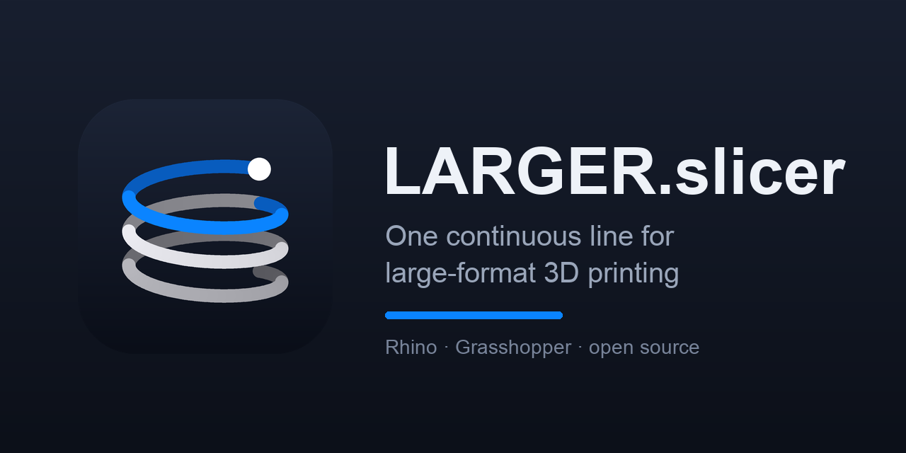
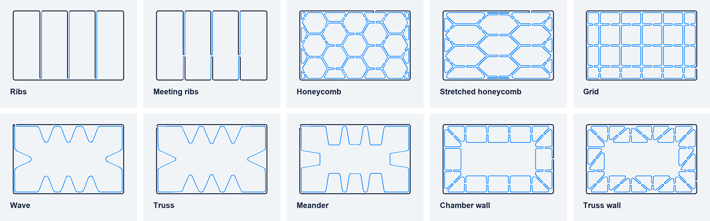
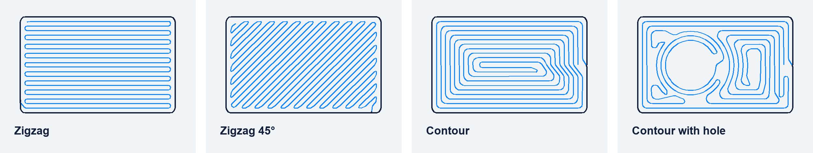

<div align="center">

<a href="https://parametricsolutions.de/de/larger-slicer/"></a>

# LARGER.slicer

**Modell rein. Eine Linie. Drucken.**<br>
Der Slicer für großformatigen 3D-Druck mit Roboter und Granulatextruder, in Rhino und Grasshopper.

[](https://github.com/Moeewe/LARGER.slicer/releases/latest) [](https://www.rhino3d.com/de/) [](#schnellstart) [](https://creativecommons.org/licenses/by-nc/4.0/deed.de)

<a href="https://github.com/Moeewe/LARGER.slicer/releases/latest/download/LARGERslicer-SETUP.zip"></a>

[Produktseite](https://parametricsolutions.de/de/larger-slicer/) · [Versionshinweise](https://github.com/Moeewe/LARGER.slicer/releases/latest) · [Dokumentation](LARGERslicer/documentations/README.md) · [Changelog](LARGERslicer/CHANGELOG.md)

[English](README.md) · **Deutsch**

</div>

---

## Eine Linie, vom Skirt bis zur letzten Lage

Ein Granulatextruder lässt sich nicht sauber stoppen: Jede Leerfahrt zieht Fäden, jeder Halt hinterlässt einen Tropfen. LARGER.slicer plant deshalb den ganzen Druck als **eine durchgehende Bahn** und prüft sie, bevor sie den Roboter erreicht.

| | |
|---|---|
| **Eine Linie** | Wände, Boden und Infill werden zu einer einzigen Bahn verbunden. Das Infill ist in die Wand eingebunden, nicht daneben gedruckt. |
| **Kreuzt sich nie** | Bei einer Kreuzung fährt die Düse durch frisch gelegtes Material. Lässt sich ein Muster nicht ohne Kreuzung drucken, wählt der Slicer ein anderes. |
| **Flache Lagen** | Jede Lage liegt flach. Die Naht bleibt um eine Bahnbreite offen; die Bahn überquert die Lücke auf einer kurzen Steigung zur nächsten Lage, immer an derselben Stelle. |
| **Aufgelegt** | Eine Bahn darf die darunter um höchstens eine halbe Bahnbreite überragen. `Path Check` meldet, wo ein Teil das überschreitet. |

## Infill aus einer Linie

Jede Zeichnung ist eine echte Lage aus dem Slicer (Bauteil 300 × 190 mm, Bahn 5 mm). Größe, Streckung, Winkel und Lage sind einstellbar.

<picture>
  <source media="(prefers-color-scheme: dark)" srcset="docs/readme-infill-dark.png">
  
</picture>

**Infill selbst zeichnen:** Kurven in der Draufsicht über das Bauteil zeichnen und an `Locations` von `Infill Ribs` anschließen: Jede Kurve, die von Wand zu Wand läuft, wird ein Steg, der ihr folgt, als Teil derselben Linie (ab 2.0.5 sortiert `Infill Ribs` sich kreuzende Kurven selbst aus, wie es `Infill Sketch` tat; `Infill Sketch` ist ausgeblendet, alte Dateien öffnen weiter).

## Böden ohne Absetzen

<picture>
  <source media="(prefers-color-scheme: dark)" srcset="docs/readme-bottom-dark.png">
  
</picture>

## Der Tab „Slicer“

Neu hier? `Easy Slicer` ist ein einzelner Baustein vom Modell bis zur geprüften Druckbahn; die Seite [Erste Schritte](https://parametricsolutions.de/larger-slicer/erste-schritte/) führt hindurch. Für alle Optionen werden die Komponenten in dieser Reihenfolge verbunden. `Quick Start` legt die ganze Kette samt Beispielteilen auf die Leinwand.

Die Einstellungen sitzen auf den Komponenten selbst: Die Zeilen unter einer Komponente sind Auswahlen, Zahlen, Schalter und Knöpfe (`Save G-code`, `Save KRL`, `Play`). Ein Klick auf die Zeile ändert sie: Eine Auswahl öffnet ein Menü. Eine Zahl zieht man nach links oder rechts (mit Shift feiner; der Balken zeigt, wo sie in ihrem Bereich liegt), klickt sie an, um einen beliebigen Wert einzutippen, oder wählt über den Pfeil rechts einen runden Wert (Winkel 0, 15, 30, 45, 60, 75, 90°). Ein Knopf schreibt seine Datei einmal pro Klick und springt von selbst zurück. Der Wert geht in den Eingang, als wäre er dort eingetippt, die Datei behält ihn also. Ein Draht in denselben Eingang hat weiterhin Vorrang (die Zeile zeigt dann „connected“).

**Lange Berechnungen laufen im Hintergrund.** `Slice`, `Walls`, `Continuous Path`, `Surface Pattern`, `Material Field`, `Self Support Check`, `Non-Planar Check` und `Robot Program` rechnen neben der Leinwand, die bedienbar bleibt; die Komponente zeigt „computing 3.2 s“ und gibt ihr Ergebnis aus, sobald es fertig ist. Ändert sich ein Eingang währenddessen, beginnt sie neu, und die laufende Rechnung hört nach etwa einer Lage auf. Komponenten unter einer, die noch rechnet, zeigen ein graues „waiting for ... (still computing)“ statt eines Fehlers. Die Zeile `Background: on` (oder der Menüpunkt „Calculate in the background“) schaltet das pro Komponente ab; die Datei behält die Einstellung.

**Geschwindigkeiten in mm/s.** `Print Settings` und `Easy Slicer` nehmen standardmäßig Speed 50, Min Speed 5 und Max Speed 200 mm/s. Die Bahn und die Maschinendateien bleiben in mm/min, dem F von G-Code und DXR: 50 mm/s = F3000. Definitionen, die mit einer älteren Version gespeichert wurden, werden als mm/min gelesen, mit einem Hinweis an der Komponente. `First Layer Speed` ist immer mm/s (ab 2.0.5 wird nicht mehr stillschweigend auf mm/min geraten).

Der Tab hat sieben Gruppen, in der Reihenfolge, in der du verbindest (das Ausklappmenü des Slicer-Panels trennt sie durch Linien):

| Gruppe | Komponente | Aufgabe |
|---|---|---|
| **1 Start** | `Quick Start` · `Easy Slicer` | Die ganze Kette mit Beispielteilen; oder ein Baustein vom Modell bis zur geprüften Druckbahn |
| | `Control Panel` · `Result` | Ohne Drähte: die wichtigsten Einstellungen aller LARGER-Komponenten der Gruppe an einem Ort (ein Draht in einen Eingang hat weiter Vorrang); das Urteil der Prüfungen, Lagen, Zeit, Material, ein Knopf für jede Datei zum Speichern, die Simulation und die Berichtszeile von Easy Slicer |
| | `Print Settings` | Bahnbreite, Lagenhöhe, Überlappung, Geschwindigkeit (mm/s), kleinster Radius. `Nozzle Preset` wählt Bahnbreite und Lagenhöhe passend zur eingeschraubten Düse. Warnt, wenn die Lagenhöhe über 0,6 × Bahnbreite liegt |
| | `Print Tuning` | Ab 2.0.5. Zwischen `Print Settings` und den Slicer-Komponenten: eine Geschwindigkeit pro Linienart (Wall, Infill, Bottom, Skirt, Support; mm/s, 0 = Druckgeschwindigkeit), `Coasting` (mm: der Extruder stoppt so viel früher vor jedem Halt und jeder Leerfahrt), `Prime` (mm Bahn extra nach einem Halt), `Travel Lift` (mm Z-Hub bei G-Code-Maschinen). `Machine G-code`, der DXR und das KUKA-Programm folgen ihm |
| | `Machine Profile` | Wie dein Drucker die Extrusionswerte erwartet: Volumen, Filamentlänge oder Faktor für die Steuerung. Aufgelistet als Hersteller und Maschine, z. B. „Generic · Pellet extruder“ |
| | `Material` · `Material Factor` | Startwerte für ein Granulat (Temperaturen, Trocknung, Dichte); ein neuer Extrusionsfaktor aus gemessenen Bahnbreiten |
| | `Design Rules` · `Print Bed` | Vor dem Modellieren: Bereich der Lagenhöhe (Ausgang `Layer Range`), Überlappung, Wandstärke für zwei Bahnen; mit `Print Settings` am Eingang `Settings` (ab 2.0.5) kommen Bahn, Lage, Düse und Überlappung von dort, sodass CO90 genau das ist, was `Walls` druckt. Das Druckbett deiner Maschine und ob die Bahnen darauf liegen |
| **2 Lagen** | `Slice` | Breps, Flächen, SubDs, Meshes. Flach, gekippt, non-planar (Führungsfläche, „Follow the part“ oder „Follow the surface“) oder multiaxial (Führungskurve) |
| | `Best Angle` · `Self Support Check` · `Self Supporting Envelope` | Der Schnittwinkel mit dem kleinsten Überhang, wo das Bauteil zu weit überhängt, und das wenigste Material, das es selbsttragend macht |
| **3 Wände und Füllung** | `Walls` | Bahn innen, mittig oder außen an der Geometrie; bei „Outside“ gehen weitere Wände nach außen (ab 2.0.5; vorher nach innen) |
| | `Bottom Fill` | Geschlossener Boden als eine Linie: Zickzack oder Kontur. `Top Layers` (ab 2.0.5) schließt das Teil oben mit vollen Lagen im selben Muster |
| | `Infill Ribs` · `Infill Cells` · `Infill Wave` · `Infill Chambers` | Infill, in die Wandlinie eingebunden. `Infill Ribs` nimmt auch gezeichnete Kurven (Zeilen `Spacing` und `Meet`). `Infill Wave` reicht die Lagen mit einer Warnung durch, wenn `Depth` zu klein ist |
| | `Support Fins` | Dünne Stützrippen außen am Bauteil, die Überhänge tragen, als Teil derselben Linie |
| **4 Bahn** | `Continuous Path` | Flache Lagen mit offener Naht (Lücke von einer Bahnbreite) oder Spirale für einfache Wände. Seam Mode, Min Layer Time, Short Lap Time, Max Volume Rate |
| | `Round Corners` | Jede Ecke wird ein Bogen (Min Radius 0 = halbe Bahnbreite, mindestens halbe Düse) |
| | `Start and End` | Anfahrt von 30 mm oberhalb, Skirt zuerst, Brim außen, innen oder beidseitig, am Ende vom Bauteil wegfahren |
| | `Surface Pattern` | Texturen in der Wand: Strick, Pixel, Rippen, Wellen, Zickzack, Punkte, hängende Schlaufen oder ein Bild, am ganzen Bauteil oder in einer gezeichneten Region. `Pitch` 0 (ab 2.0.5 der Standard) = drei Bahnbreiten |
| | `Weave Zones` · `Weave` | Findet, wo zwei Bahnen einer Lage nebeneinander liegen (zwei Wände, Infill an der Wand, die zwei Linien eines Stegs), und verzahnt sie: Die Naht zwischen ihnen wandert von Lage zu Lage (Versatz, Breite, Schlange, Helix, Zähne ...) |
| | `Shape Field` · `Reshape Path` · `Compare Variants` | Wie hoch das Teil über seinem Grundriss werden soll (aus einer Tragwerksanalyse, Punkten, einem Profil ...); eine fertige Bahn danach umgeformt, mit gleich vielen Lagen (sie fächern auf), mit eigener Prüfung (Kipp-, Dreh- und Flussgrenze); mehrere Felder und Varianten nebeneinander in einer Tabelle (Eingänge `Flat Layers` und `Roof` wie an `Reshape Path`) |
| **5 Prüfen** | `Path Check` | Auflage, Selbstkreuzung, Bahnform, Leerfahrten, Lagenzeiten |
| | `Non-Planar Check` · `Multi-Axis Check` | Bahnhöhe und Freiraum des Druckkopfs bei non-planaren Lagen mit senkrechter Düse; dasselbe entlang einer gekippten Werkzeugachse, mit Neigung, Drehgeschwindigkeit und Fluss. Beide nutzen dieselbe Grenze der Bahnhöhe (0,8 × Bahnbreite, am gedruckten Kopf kalibriert; ein von Hand gesetztes `Max Layer` hat Vorrang) und geben NaN statt 0 für Punkte, die sie nicht messen konnten |
| | `Path Heat` | Zeichnet eine Bahn eingefärbt nach einem Wert pro Punkt (Lagenhöhe, Neigung ...), mit Titel und Farbskala. NaN-Punkte sind grau und zählen nicht zum Bereich; jede Legende bekommt ihren eigenen Platz |
| | `Weave Variants` · `Weave Test` · `Joint Data` | Dieselben Zonen auf vierzehn Arten verwoben und gleich gemessen; eine Testreihe verwobener Doppelwand-Stücke; die Fugen einer Bahn als Daten für Analyse und Versuche |
| | `Extrusion and Speed` | Ebene, E und F pro Punkt für DXR Generator oder G-Code |
| | `Material Field` | Bringt die Bahn als richtungsabhängiges Materialfeld zurück aufs Bauteil, für eine FE-Analyse |
| **6 Ausgabe** | `Machine` · `Machine G-code` | Eingebaute G-Code-Maschinen (z. B. „Ginger Additive · Ginger One (Klipper)“) oder eigene: Start-, Lagen- und Endcode und E-Faktor als `.machine`-Datei in Dokumente/LARGER/Machines. So entsteht auch der G-Code für den Ginger One |
| | `Desktop Test Print` | Derselbe Pfad verkleinert als G-Code für einen Filamentdrucker |
| | `Printer Simulation` | Der Druckkopf fährt die Bahn auf der Maschine ab, mit Schieberegler oder Play |
| | `Toolpath to Robot Lines` | PTP-Zeilen für den DXR Generator (Weber DXR), mit einer Markierung `; layer N` pro Lage |
| | `Import G-code` | Liest G-Code anderer Slicer oder eine .dxr-Datei als Bahn ein, zur Prüfung mit `Path Check` |
| | `Reshape Code` | Formt eine fertige G-Code- oder .dxr-Datei nach einem Shape Field um: Nur die Zahlen, die sich ändern, werden neu geschrieben |
| **7 Kurvenwerkzeuge** | `Layers to Curves` · `Curves to Layers` · `Curve Fill Zigzag` · `Curve Fill Cells` · `Curve Continuous Infill` · `Curve Wall and Zigzag` · `Curve Join and Order` · `Curve Uncross` | Für eigene Kurven statt eines Modells: Lagen als Kurven und zurück, eine Umrandung als eine Linie gefüllt, Kurven zu einer Bahn ohne Kreuzungen verbunden. `Layers to Curves` gibt auch die echten Konturen non-planarer Lagen aus; `Curves to Layers` nimmt für die erste Lage die First Layer Height. Nur über die Suche zu finden (Doppelklick auf die Leinwand): `Align Curves`, `Alternate Curves`, `Join Open Contours` und ab 2.0.5 `Curve Continuous Path`, `Curve Fill Contour`, `Curve Fill Euler`, `Curve Fill Cross Lines` und `Curve Bridge` (sie machen dasselbe wie `Curve Continuous Infill`, `Curve Fill Zigzag` und `Curve Join and Order`) |

Aus dem Tab ausgeblendet, alte Dateien öffnen weiter: `Ginger G-code` (ab 2.0.5; stattdessen `Machine` mit dem Ginger One und `Machine G-code`, wie in `Quick Start`), `Infill Sketch` (stattdessen `Infill Ribs`), `Slice Options`.

`Quick Start` legt acht Beispiele an: 01 flache Lagen, 02 non-planar, 03 multiaxial, 04 ein Teil mit Öffnung, 05 schräge Lagen, 06 `Easy Slicer` (eine Vase als Spirale), 07 ein non-planarer Kopf am Ginger One (Klipper), entlang seiner eigenen Oberfläche geschnitten („Follow the surface“), mit Printer Simulation, und 08 eine Vase mit `Surface Pattern`. Ab 2.0.5 steht neben jedem Slicer-Beispiel ein `Control Panel` und ein `Result`, und Ausgang A schreibt den G-Code mit `Machine` + `Machine G-code`.

### Neue Komponenten im Detail

<details>
<summary><b>Material, Material Factor, Import G-code, Material Field</b></summary>

**`Material`** (Slicer). Startwerte für ein Granulat: Einzugszone, Heizzonen 1 bis 3, Düse und Bett in °C, Trocknung, Restfeuchte und Dichte in g/cm³. Eingebaut sind Carbon-P PETG, rPETG und PLA mit den Startwerten der Weber-DXR-Kurzanleitung; die Dichten sind typische Werte.
- Eingänge: `Material` (Auswahl auf der Komponente), optionale Werte, die das gewählte Material überschreiben (Zonen als ein Wert oder Bereich wie 200-210), `Factor` und der Knopf `Save material`.
- Verbindung: `Density` → `Density` von `Print Settings`, damit Dateinamen und Berichte das richtige Gewicht zeigen.
- Eigene Materialien: `.material`-Textdateien in Dokumente/LARGER/Materials, oder die Eingänge ausfüllen und `Save material` drücken.
- Achtung: Die eingebauten Temperaturen sind Startwerte. Mit dem Datenblatt deines Materials abgleichen.

**`Material Factor`** (Slicer). Ermittelt einen neuen Extrusionsfaktor aus einem Testdruck: neu = Sollbreite / gemessene Breite × aktueller Faktor.
- Eingänge: `Target Width` (mm, Standard 5), `Measured Widths` (mm, mehrere Werte: der Mittelwert zählt), `Current Factor` (Standard 1), optional `Wall Thickness` (mm) eines einwandigen Tests.
- Ausgänge: `New Factor`, `Off` (% der Sollbreite, + = zu breit), `Mean`, `Report`.
- Verbindung: `New Factor` als `Factor` in `Machine Profile` verwenden, oder als P1 am Weber DXR, und den Test erneut drucken. Wenn du mit `Machine G-code` schreibst, den kalibrierten Faktor als `Extrusion Factor` an `Machine` setzen: Das Extrusionsprofil der Maschine ersetzt ein `Machine Profile` aus `Print Settings` (`Machine G-code` warnt dann).- Achtung: an mehreren Stellen messen. Der Bericht warnt bei ungleichmäßigen Messwerten.

**`Import G-code`** (Slicer). Liest G-Code aus Cura, Simplify3D, PrusaSlicer, AiSync / Ai Build oder einem Skript, oder eine Weber-`.dxr`, und prüft ihn wie eine eigene Bahn: Starts und Stopps, Leerfahrten, Rückzüge, F-Wechsel und F0, Extrusion ins Bett, Bahnen ohne Auflage, Kreuzungen, Zeit und Gewicht. Schräge Lagen und A/B/C-Werkzeugachsen werden erkannt.
- Eingänge: `File`, `Bead Width` und `Layer Height` (mm, 0 = aus der Datei geschätzt), optional `Machine Profile` (was E bedeutet; leer = E ist ein Volumen in mm³), `Density` (g/cm³, Standard 1,25) und der Schalter `Keep start code`.
- Ausgänge: `Toolpath`, `Path`, `Layers`, `Report`.
- Verbindung: `Toolpath` → `Path Check`, `Robot Program` oder die DXR-Komponenten.
- Achtung: Ist E eine Filamentlänge oder enthält einen Faktor, das passende `Machine Profile` anschließen, sonst stimmen die Bahnbreiten nicht.

**`Material Field`** (Slicer). Bringt die Bahn als richtungsabhängiges Materialfeld zurück aufs Bauteil, für FE oder IGA. Pro Messpunkt: Bahnrichtung e1, quer zur Bahn e2, Stapelrichtung e3, Lage und Bahn, Abstand zur nächsten Lagen- und Bahngrenze, Lagenzeit und ein Schwächewert. Mit den Moduln ergibt sich die gedrehte orthotrope Steifigkeit pro Punkt.
- Eingänge: `Toolpath`, optional `Geometry` (Breps: die Punkte bilden ein Raster im UV jeder Fläche, sodass Fläche, u, v auf die NURBS der Analyse passen) oder `Sample Points` (z. B. Gauß-Punkte), `Sample Spacing` (mm, 0 = halbe Lagenhöhe), Moduln E1, E2, E3, G12, G13 (MPa) und Querkontraktionszahlen, `Cooling Time` (s, Standard 60), `File`, `Format` (CSV, JSON, VTK für ParaView) und der Knopf `Save`.
- Ausgänge: `Points`, `Frames`, `Directions`, `Stacking`, `Weakness` (0 = intakt, 1 = schwach), `Weakness Mesh`, `Table`, `Info`.
- Achtung: Die voreingestellten Moduln und die Abkühlzeit sind Platzhalter. Durch Werte aus Probekörperversuchen mit deinem Material ersetzen.

</details>

<details>
<summary><b>Self Support Check, Self Supporting Envelope, Best Angle, Support Fins</b></summary>

Die Grenze für Überhänge ergibt sich aus der Bahn: Eine Bahn darf um `Factor` × Bahnbreite neben der Bahn darunter liegen (Standard 0,5). Bei 5-mm-Bahnen in 2-mm-Lagen darf eine Wand etwa 51° gegen die Aufbaurichtung geneigt sein.

**`Self Support Check`** (Slicer, neben `Slice`). Färbt das Bauteil danach, wie weit es für die gewählte Aufbaurichtung überhängt: grün gut, orange nahe der Grenze, rot nicht selbsttragend, grau auf dem Bett.
- Eingänge: `Geometry`, `Settings` (aus `Print Settings`), `Plane`, `Angle` (Grad), optional `Guide` und `Guide Mode`, alles wie an `Slice`, und `Factor`.
- Ausgänge: `Analysis Mesh`, `Unsupported Area` (mm²), `Percent`, `Regions`, `Starts` (Inseln, die frei in der Luft beginnen), `Report`.
- Achtung: dieselbe Ebene, denselben Winkel und dieselbe Führung wie an `Slice` verwenden, sonst wird eine andere Aufbaurichtung geprüft.

**`Self Supporting Envelope`** (Slicer). Fügt das wenigste Material hinzu, mit dem jede Lage die darüber trägt, wie automatische Fasen unter Überhängen.
- Eingänge: `Layers` aus `Slice` (vor `Walls`), `Settings`, `Factor`, Schalter `Geometry` (das neue Bauteil auch als Geometrie bauen).
- Ausgänge: `Layers` (fertig zum Weiterverarbeiten: an `Walls` anschließen), `Geometry` (das neue Bauteil als geschlossener NURBS-Brep oder Mesh), `Added` (nur das hinzugefügte Material), `Contours`, `Added Contours`, `Report`.
- Achtung: Das hinzugefügte Material verändert das Bauteil. Abfräsen einplanen; das Bauen der Geometrie (ein Loft) dauert einen Moment.

**`Best Angle`** (Slicer). Probiert Schnittwinkel in 5°-Schritten und mit `Turn` jede Kipprichtung in 30°-Schritten, und schlägt die mit dem kleinsten Überhang vor.
- Eingänge: `Geometry`, `Settings`, `Min Angle` und `Max Angle` (Grad, Standard 0 bis 75), `Turn`, `Factor`.
- Ausgänge: `Plane` und `Angle` (beide an `Slice` anschließen), `Layer Plane`, `Report` mit der Rangfolge.
- Achtung: Ein schräger Druck braucht einen Roboter oder ein gekipptes Bett und meist Opferlagen (`Slice`, `Sacrificial Layers`; bis 2.0.4 `Start/End Layers`).

**`Support Fins`** (Slicer, neben dem Infill). Dünne Rippen außen am Bauteil tragen Überhänge. Jede Rippe steht senkrecht zur Außenwand, vom Bett bis knapp unter den Überhang, als Haarnadel aus der Wand hinaus und zurück, und bleibt so Teil der einen Linie.
- Eingänge: `Layers` (nach `Walls`, `Bottom Fill` und Infill), `Settings`, `Overhang Angle` (Grad gegen die Senkrechte, 0 = eine halbe Bahn pro Lage), `Spacing` (Bahnbreiten, Standard 15), `Reach` (Bahnbreiten, Standard 1), `Contact` (Neck, Neck + gap, Full), `Gap` (mm, Standard 0,3, für Neck + gap).
- Verbindung: direkt vor `Continuous Path`. Die Nahtrampe hält sich von den Rippen fern.
- Achtung: „Full“ ist die festeste Verbindung, aber am schwersten zu entfernen. „Neck + gap“ druckt die oberste Rippenlage tiefer, sodass der Überhang abbricht.

</details>

<details>
<summary><b>Surface Pattern: Strick, Rippen, Wellen, Schlaufen, Bilder</b></summary>

**`Surface Pattern`** (Slicer, Gruppe Toolpaths, nach `Continuous Path`, vor `Start and End`; arbeitet an jedem Toolpath). Jede Lage ist eine Reihe von Punkten. Die Punkte werden im Rhythmus entlang der Wandnormalen nach außen gezogen, und der Rhythmus wandert von Lage zu Lage weiter. Kleine Auslenkungen ergeben feinen Strick oder Pixel; große lassen die Bahn zwischen den Punkten, die auf der Lage darunter liegen, überhängen, und mit `Z Droop` und `Extra Flow` hängt sie zu Schlaufen durch.
- Eingänge: `Toolpath`, `Pattern` (Knit, Ribs, Waves, Zigzag, Dots, Loops, Image), `Amplitude` (mm, wie weit nach außen), `Pitch` (mm, eine Wiederholung entlang der Lage; so angepasst, dass eine ganze Zahl von Wiederholungen um eine geschlossene Wand passt), `Layer Period` (Lagen pro Reihe), `Phase Shift` (Anteil des Pitch pro Reihe: 0 übereinander, 0.5 verwoben, 0.05 diagonal), `Z Droop` (mm), `Extra Flow` (Anteil), `Side` (außen oder innen), `Region` (geschlossene Kurven auf dem Bauteil, Breps oder Meshes) und `Falloff` (mm, weicher Rand), `Attractors` (Punkte oder Kurven) und `Reach` (mm), `Image` (Dateipfad eines Graustufenbilds, dunkel = Muster; ein bloßer Dateiname wird neben der .gh-Datei gesucht) und `Invert`.
- Ausgänge: `Toolpath`, `Preview` (eine Polylinie pro Lage), `Hanging` (Punkte mehr als eine halbe Bahn neben der Lage darunter), `Info`.
- Regionen: Eine geschlossene Kurve wird mit der Wand abgewickelt (Bogenlänge quer, Höhe nach oben); ein Bahnpunkt bekommt das Muster, wenn er dort innerhalb der Kurve liegt. Ein geschlossener Brep oder ein Mesh: Punkte darin. Eine offene Fläche auf der Wand: Punkte darauf.
- Die Bahn bleibt eine Linie: Nur Wandpunkte bewegen sich, Nahtrampen, Brücken, Rippen und Infill bleiben, das Muster läuft an der Naht aus, und wo eine Auslenkung die Bahn kreuzen würde, wird sie kleiner. Die erste Lage bleibt glatt.
- Achtung: Bis zur halben Bahnbreite liegt jede Bahn auf der darunter. Mehr ist absichtlich erlaubt (Pixel, Schlaufen); `Info` zählt diese Punkte und `Path Check` listet sie als nicht gestützt, also mit dem Auge beurteilen. Die Extrusion folgt der längeren Bahn von selbst; `Extra Flow` gibt an den Spitzen mehr dazu, und `Max Volume Rate` in `Continuous Path` begrenzt den Extruder weiterhin.
- Beispiel: `EXAMPLE FILES/LARGERslicer - Surface Patterns.gh` (sechs Vasen: Strick, Rippen, Wellen, Schlaufen, ein Gitterbild, eine Region).

| Wirkung | Pattern | Amplitude | Pitch | Phase Shift | Layer Period | Z Droop / Extra Flow |
|---|---|---|---|---|---|---|
| Feiner Strick, Pixel | Knit | 0.4 bis 0.6 x Bahn | 2 x Bahn | 0 | 1 | 0 / 0 |
| Senkrechte Rippen | Ribs | 0.5 bis 1 x Bahn | 3 x Bahn | 0 | 1 | 0 / 0 |
| Tiefe Sinuswände (übereinander) | Waves | 2 bis 4 x Bahn | 6 bis 10 x Bahn | 0 | 1 | 0 / 0 |
| Verwobene Wellen, Lagen versetzt | Waves | 1.5 bis 2 x Bahn | 6 x Bahn | 0.5 | 1 | 0 / 0 |
| Diagonale Bänder | Waves oder Knit | 1 x Bahn | 3 bis 6 x Bahn | 0.03 bis 0.08 | 1 | 0 / 0 |
| Schuppen, Noppen | Dots | 0.8 x Bahn | 3 x Bahn | 0 | 2 | 0 / 0 |
| Hängende Schlaufen | Loops | 2 bis 4 x Bahn | 4 bis 5 x Bahn | 0.5 | 2 | 1 Lage / 0.3 |
| Bild oder Gitter | Image + Bild | 0.6 x Bahn | 1.5 x Bahn | 0 | 1 | 0 / 0 |
| Textur nur in einem Feld | beliebig + Region-Kurve | | | | | |

</details>

<details>
<summary><b>Slice „Follow the part“ und „Follow the surface“, Non-Planar Check, Optionen von Continuous Path und Path Check</b></summary>

**`Slice`, Guide Mode „Follow the part (no guide)“.** `Guide` leer lassen. Die non-planaren Lagen folgen der Wand des Bauteils von unten nach oben, sodass Überhänge gleich dicke Lagen bekommen, ohne Führungsfläche. Die Düse bleibt senkrecht, und die Extrusion folgt der Höhe über dem nächsten Punkt der Runde darunter, nur deren senkrechtem Anteil (wo die Wand fast flach wird: seitlicher Schritt x `Skin Thickness` / Bahnbreite, siehe unten). Eine Warnung erscheint, wenn eine Lage entlang der Wand dicker als 0,8 × Bahnbreite wird. Passt das Bauteil nicht, meldet `Slice` das und schneidet flach.

**`Slice`, Guide Mode „Follow the surface (no guide)“.** `Guide` leer lassen und `Continuous Path` im Modus Spiral verwenden. Für geschlossene Teile wie einen Kopf, so wie der Kopf „UNIKAT HEAD V2“ 2024 auf dem Ginger One gedruckt wurde: Ringe auf der Oberfläche des Teils vom Ring, auf dem es steht, bis zum Scheitel (an der Wand der Weg entlang der Oberfläche vom unteren Ring, so dass die Ringe überall eine Lagenhöhe entlang der Oberfläche auseinander liegen und unter Kinn und Nase so tief eintauchen, wie die Oberfläche es verlangt, beim Beispielkopf bis etwa 18 mm je Ring; zum Scheitel hin der Anteil des Weges zum Scheitel, so dass die letzten Ringe ihn schließen), auch unter Kinn und Nase, und oben geschlossen. Die ersten beiden Lagen liegen flach (erste Lagenhöhe, dann eine Lagenhöhe höher). Die Düse bleibt senkrecht. Die Bahnhöhe jedes Punktes folgt dem **Schalengesetz**, gemessen am nächsten Punkt des Rings darunter: eine eine Bahn breite Wand wächst je Ring um Bahnbreite x senkrechten Abstand, egal wie weit der Ring übersteht (ein seitlicher Versatz verschiebt Material, er fügt keins hinzu); wo die Ringe vor allem seitlich wandern (Scheitel, unter dem Kinn), bilden sie eine Haut: t = max(dz, dxy x Skin Thickness / w), und E folgt ihr. (Bis 1.3.0 galt das Gesetz des Drucks von 2024, t = dz + (h - dz) x dxy / w; es hat die angelehnten Ringe überextrudiert, zum Scheitel hin bis etwa 50 % je Ring.) Non-Planar Check misst nach dem Schalengesetz, lässt keine Bahn über 0,8 x Bahnbreite zu, unter 0,4 x Lagenhöhe bis 1 % der Punkte (Scheitel), und benennt E nach dem alten Gesetz. Path Check lässt Ringe bis eine Bahnbreite neben dem Ring darunter an 2,5 % der Punkte nur in kurzen Stücken zu (höchstens 12 Bahnbreiten, gehalten wie eine kurze Brücke); Streifen der Düse bis 0,6 mm werden genannt, nicht gezählt. Beispiel: [`LARGERslicer - Head (Ginger One Marlin, non-planar).gh`](<EXAMPLE FILES/00 - WEBER - GINGER [Robotic] 3D Printing/LARGERslicer - Head (Ginger One Marlin, non-planar).gh>).

**`Non-Planar Check`** (Slicer, neben `Path Check`). Für Drucker mit senkrechter Düse. Misst an jedem Punkt die echte Bahnhöhe gegen Bahnbreite, Lagenhöhe und Extrusion und prüft den Druckkopf gegen alles, was vorher gedruckt wurde.
- Eingänge: `Toolpath`, `Tip Radius` (mm, Standard 4), `Cone Angle` (halber Kegelwinkel gegen die Senkrechte, Grad, Standard 30), `Cone Length` (mm, Standard 60), `Head Radius` (mm, Standard 40), `Pose` (0 = Anfang, 1 = Ende).
- Ausgänge: `OK`, `Report`, `Bead Height` (mm pro Punkt; NaN, wo ein Punkt nicht gemessen werden konnte), `Bad Heights`, `Collisions` (muss leer sein), `Head` (der geprüfte Kopf, auf der Bahn bei `Pose`).
- Die Grenze der Bahnhöhe ist 0,8 × Bahnbreite, dieselbe wie in `Multi-Axis Check` (am gedruckten Kopf V2 kalibriert).
- Achtung: die eigene Düse und den eigenen Kopf ausmessen. Die Standardwerte sind nur Beispiele.

**`Continuous Path`, neue Eingänge** (Lagenmodus):
- `Seam Mode`: Fixed point (wie bisher), Inner corner (in einer Innenecke der Außenwand, wo sie am wenigsten auffällt; ohne Innenecke die schärfste Außenecke) oder Sharpest corner. Die Ecke wird von Lage zu Lage verfolgt, höchstens eine halbe Bahn zur Seite.
- `Min Layer Time` (s, 0 = aus): Lagen, die schneller fertig wären, werden langsamer gedruckt, mit einer Geschwindigkeit pro Lage, nie unter Min Speed. Etwa 60 s passen zu vielen großen Granulatdrucken.
- `Short Lap Time` (s, 0 = Min Layer Time): die Mindestzeit für kurze Runden, kürzer als min + 0,7464 x (max - min) aller Rundenlängen, mit einem Übergang über 5 Runden, wie beim 2024 gedruckten Kopf (Min Layer Time 35 s, Short Lap Time 40 s).
- Ecken und gerade Kanten bleiben, wo die Wand ist; die Nahtrampe läuft entlang der Wand und schneidet keine Ecke ab. Skirt- und Brim-Ringe enden eine Bahnbreite vor ihrem Anfang und gehen rechtwinklig in den nächsten Ring über, der innerste läuft in den Anfang des Teils.
- `Max Volume Rate` (mm³/s, 0 = aus): Bewegungen, die mehr vom Extruder verlangen würden, laufen langsamer. Der Ginger One schafft etwa 330 mm³/s.
- `Skin Thickness` (mm, 0 = Lagenhöhe, nie unter 0,4 x Lagenhöhe): nur non-planar. Wo die Runden vor allem seitlich wandern (Scheitel, unter dem Kinn), bekommt die Bahn seitlichen Schritt x Skin Thickness / Bahnbreite statt des (kleinen) senkrechten Abstands.

**`Path Check`**: Eingang `Min Layer Time` (s, 0 = der Wert von `Continuous Path`) und Ausgang `Layer Times` (s pro Lage). Für zu kurze Lagen nennt der Bericht drei Abhilfen: langsamer drucken, mehrere Teile nebeneinander, oder als letzte Möglichkeit eine Pause.

</details>

<details>
<summary><b>Maschinen und Düsen-Voreinstellungen</b></summary>

- Maschinen und Maschinenprofile sind als Hersteller und Maschine aufgelistet: „Ginger Additive · Ginger One (Klipper)“, „Weber Additive · DXR25 on a robot“, „Generic · Filament printer 1.75 mm“. Eigene `.machine`-Dateien können `manufacturer = ...` enthalten.
- **Ginger Additive · Ginger One (Klipper)**: Makros START_PRINT und END_PRINT, E als Volumen × 1,0, Lüfter ab Lage 1. Den Faktor mit der Klipper-`rotation_distance` deines Extruders bestätigen.
- `.machine`-Dateien kennen `material` und `bed temperature` für `{material}` und `{bed}` in den Codes, und Blöcke `[after layer n]`. `Machine` hat die optionalen Eingänge `Material` und `Bed Temperature` (°C).
- Die Düsen-Voreinstellungen (`Nozzle Preset` an `Print Settings` und `Easy Slicer`; bis 2.0.4 `Nozzle`) heißen nach der Düse, z. B. „3 mm flat nozzle, wide bead - bead 5 mm, layer 2 mm (tested)“ oder „4 mm nozzle (Weber profile) - bead 4.8 mm, layer 1.8 mm“. Eine Warnung erscheint, wenn Bahn und Lage nicht zur Düse passen.

</details>

## Der Tab „Robot“

Für das Drucken mit dem Roboter, einem KUKA oder einem Arm von Universal Robots: Die Zelle wird einmal beschrieben, danach wird jede Bahn zu Roboterbewegungen mit der echten Werkzeugorientierung, als KRL für den KUKA oder URScript für einen UR. Eine Kette für beide: `Robot` → `Robot Tool` → `Robot Cell` → `Robot Program` → `Robot Simulation`.

| Baustein | Was er macht |
|---|---|
| `Robot` | Der Arm: voreingestellt der KUKA KR120 R2700-2, ein Arm von Universal Robots (UR3, UR3e, UR5, UR5e, UR10, UR10e) oder jeder Sechsachser mit Zentralhand aus einer Bibliotheksdatei des Robots-Plug-ins (.xml). Warnt, wenn eine `Library`-Datei das gewählte UR-Modell überschreibt |
| `Robot Tool` | Voreinstellungen: AE20-Extruder (Weber DXR25, KUKA), Tonextruder V2, Stifthalter, Wollspinner (UR5); oder „Own tool“: Werkzeugspitze (TCP) wie im Robots-Plug-in bzw. bei KUKA (Z von der Spitze zurück ins Werkzeug; AE20: YZ-Ebene bei -460, 3, 108), Gewicht, Schwerpunkt, 3D-Modell. An einem UR wird der TCP so gedreht, dass Z aus dem Werkzeug zeigt, wie URScript es erwartet |
| `Robot Cell` | Roboter, Werkzeug und die Basis, von der aus das Programm zählt (KUKA `$BASE`). Optionale Eingänge `Environment` (Meshes für die Kollisionsprüfung) und `External Axes`. Warnt, welche Eingänge ein UR nicht nutzt |
| `External Axis` | Eine Linearachse, auf der der Roboter steht, oder ein Drehtisch, auf dem das Bauteil steht. An `External Axes` von `Robot Cell` anschließen (nur KUKA) |
| `Robot Program` | Werkzeugspitze auf jedem Bahnpunkt, Werkzeug entlang der Werkzeugachse der Bahn. Prüft Reichweite, Achsbereiche, Handachsen-Singularität, Achsgeschwindigkeit und Kollisionen (KUKA). Ausgang `Code` (KRL oder URScript; bis 2.0.4 `KRL`), die Bewegungen für den `DXR Generator` und der Arm an jeder Stelle der Bahn. Für einen UR: `Blend`, `Robot IP`, `Save script` und `Upload to robot` (siehe unten) |
| `Robot Simulation` | Spielt das Programm ab: der Roboter mit Werkzeug zu jedem Zeitpunkt des Drucks (Schieberegler oder Play). Ausgang `Colliding` zeigt rot, was in diesem Moment kollidiert |
| `Cell Geometry` | Eine Beispiel-Druckzelle in 3D (Boden, Sockel, Bett, Zaun; die Zelle der FH Münster), der Standort des Roboters und die Umgebung für die Kollisionsprüfung. Eigene Zelle als .3dm-Datei |

**Weber DXR25 mit dem AE20:** Ab 2.0.5 nimmt `Robot Program` mit dem Werkzeug AE20 das Extrusionsprofil des Weber DXR25 (1,128), wenn die Bahn das Ginger- oder ein Filamentprofil trägt, und sagt das; bei jedem anderen fremden Profil warnt es. Auch `Toolpath to Robot Lines` warnt bei einem fremden Profil.

<details>
<summary><b>Universal Robots (UR3, UR5, UR10 und ihre e-Series)</b></summary>

Den Arm in `Robot` wählen, eine Voreinstellung in `Robot Tool`, dann `Robot Cell` → `Robot Program` → `Robot Simulation`. Beispiel: Beispiel 06 in `LARGERslicer - Beispiele für Studierende.gh` (eine Tonvase auf dem UR5 der FH Münster). Mehr (englisch): [docs/UR5.md](docs/UR5.md).

- `Robot Program` schreibt URScript: set_tcp und set_payload, den Startcode (der Startcode der FH fragt zuerst nach Druckluft), Extruder an und aus, wo der Druck beginnt und endet, movel entlang der Bahn mit `Blend`, und die Anfahrt als Gelenkbewegung zu den berechneten Gelenkwinkeln (`movej([...])`), damit der Roboter in der Stellung fährt, die simuliert wurde.
- Geprüft: Reichweite von der Startstellung, Traglast, Handachsen-Singularität (Achse 5 nahe 0) und Gelenkgeschwindigkeit gegen die Grenzen des Modells. Der Bericht meldet NOT RUNNABLE oder TOO FAST, wenn etwas davon nicht passt. An einem UR nicht geprüft: Kollisionen, externe Achsen, Werkbasis; der Bericht sagt das.
- `Upload to robot` schickt das Programm nur an `Robot IP`, wenn es OK ist. Der Roboter führt das Skript sofort aus (bei der e-Series nur im Fernsteuerungsmodus). `Save script` schreibt eine `.script`-Datei.
- `UR Cell`, `UR Program` und `UR Simulation` (2.0.3) sind ausgeblendet; alte Dateien öffnen weiter.

</details>

<details>
<summary><b>Externe Achsen und Kollisionsprüfung</b></summary>

**`External Axis`** (Robot). Eine Linearachse (der Roboter fährt darauf) oder ein Drehtisch (das Bauteil dreht sich darauf). `Robot Program` bewegt sie während des Drucks: Die Linearachse hält den Roboter neben dem Punkt, der gerade gedruckt wird, der Tisch dreht diesen Punkt zum Roboter. Beide bewegen sich ruhig, unter ihrer Höchstgeschwindigkeit und innerhalb ihres Bereichs.
- Eingänge: `Kind` (Linearachse oder Drehtisch), `Place` (Linearachse: fährt entlang ihrer X-Achse; Tisch: Ursprung = Mitte, Z = Drehachse, X = 0°), `Min` und `Max` (mm bei der Linearachse, Grad beim Tisch; beide 0 = Linearachse 0 bis 3000 mm, Tisch -360 bis 360°), `Max Speed` (mm/s bzw. °/s; 0 = 1000 mm/s bzw. 90 °/s), `Name` (KUKA E1 bis E6), `Endless`, `Offset` (mm bzw. Grad), `Smoothing` (mm Bahn, Standard 300), `Coupled` (KUKA-gekoppelte Basis), `Size` (mm, nur Darstellung).
- Verbindung: `External Axis` → `External Axes` von `Robot Cell` (eine Linearachse und ein Tisch pro Zelle).
- Achtung: KRL schreibt E1/E2 in jede Zeile, die DXR-Ausgabe enthält aber keine E-Werte. Noch nicht an einer Steuerung erprobt: zuerst in T1 laufen lassen.

**Kollisionsprüfung in `Robot Program`.** Roboter, Werkzeug, Linearachse und Drehtisch werden gegeneinander geprüft, gegen das bisher gedruckte Bauteil, das Bett und das `Environment` von `Robot Cell`.
- Eingänge: `Check Collisions` (standardmäßig an; auch als Zeile auf der Komponente), `Clearance` (mm, Standard 10: Körper, die sich näher kommen, werden als Beinahe-Kollision gemeldet), `Collision Poses` (wie viele Stellungen entlang der Bahn, Standard 500; -1 = jede Bewegung, 0 = keine Prüfung).
- Ausgänge: `Collision Moves` (Nummern der Bewegungen, wie `Move` von `Robot Simulation`), `Collision Bodies` (die Körper bei ihrer schlimmsten Kollision, mit einer Kugel an der Berührstelle), `Collisions` (Bahnpunkte).
- Der Bericht nennt das Paar, die Bewegung und die Lage und schlägt vor, was sich ändern lässt: Neigung, Düsenlänge, Werkzeugdrehung, Versatz von Linearachse oder Drehtisch.
- Achtung: Die Prüfung braucht das 3D-Modell des Roboters (siehe Info von `Robot`); ohne es werden Kollisionen nicht geprüft. Ein Werkzeug ohne Mesh wird als einfacher Zylinder vom Flansch bis zur Spitze geprüft, also den eigenen Extruder als `Mesh` an `Robot Tool` anschließen.

</details>

Die kurvenbasierten Werkzeuge des früheren Tabs „Toolpaths“ sind jetzt die letzte Gruppe des Tabs „Slicer“ (siehe oben) und heißen wie ihre Gegenstücke im Slicer (`Curve Fill Zigzag`, `Curve Fill Contour`, `Curve Fill Cells`, `Curve Continuous Path`, `Curve Uncross` ...).

## Die Tabs „DXR“, „CNC“, „Formwork“, „Export“ und „Utilities“

| Tab | Baustein | Was er macht |
|---|---|---|
| **DXR** | `Machine Settings` · `Machine Settings Extended` | Temperaturen und Kühlung für Anfang und Ende einer Weber-DXR-Datei; die erweiterte Fassung mit 4 Bettzonen und den Extruderzonen |
| | `Fan Schedule` | Kühlung nach Lage: aus für die ersten Lagen, dann wenig, später voll (Rampe oder eigene Stufen). Zwischen `Machine Settings` und `DXR Generator`. Im erweiterten Format schreibt es `V.E.GLOBAL[3]` auf der Skala 0-255 von Fan Speed (Prozent × 2,55). Ab 2.0.5 nimmt es auch eine G-Code-`Machine`: Dann schreibt `Machine G-code` nach den Lagen `M106 S0-255` / `M107` statt der eigenen Lüfterzeilen der Maschine |
| | `DXR Generator` | Roboterzeilen, Extrusion und `Feed (mm/min)` (bis 2.0.4 `Speed`) zu einer DXR-Datei; schaltet den Lüfter beim Lagenwechsel |
| | `G-code to DXR` | G-Code aus Cura und anderen Slicern zu einer DXR-Datei (bis 2.0.4 `DXR GCode Postprocessor`). Angeschlossene `Machine Settings` haben Vorrang vor den Temperaturen im Kopf des G-Codes und behalten den Fan Schedule |
| | `DXR File Health Check` | Prüft eine DXR-Datei vor dem Druck: Name, Lesbarkeit, Inhalt, keine Bewegung mit Vorschub 0 |
| | `DXR Variable Width` · `DXR E Remap` · `G-code Diff Check` · `DXR Width Preview` · `Surface Thickness Heatmap` | Zweite Reihe (aus Utilities hierher verschoben): Extrusion entlang X, Y oder Z skaliert; die XE-Werte eines DXR-Programms aus mehreren Teilen mit je eigener Wandstärke neu berechnet (war `GCode E Remap MultiPart`); zwei G-Code-Dateien Zeile für Zeile verglichen; ein DXR-Programm nach Bahnbreite eingefärbt (war `Fast GCode DXR Preview`); die Wandstärke jedes Teils als farbiges Mesh, mit der Part Info für `DXR E Remap` |
| **CNC** | `CNC - Quick Start` | Legt die ganze Fräskette mit einem Beispiel an: Topografie geschruppt, geschlichtet und ausgeschnitten |
| | `CNC - Plate` | Schritt 1: die Rohplatte, wie sie auf dem Tisch der Zünd liegt, wo das Modell darin liegt, das Material |
| | `CNC - Cutter` | Schritt 2: ein Fräser und sein Platz im Magazin. Cutter 6 = eigener Flachfräser, 7 = eigener Kugelfräser mit den Eingängen `Diameter`, `Cutting Length`, `Max Depth`, `Spindle Speed`; `Module` (11/21/31) für jeden Fräser (ab 2.0.5; `CNC - Own Cutter` ist ausgeblendet, alte Dateien öffnen weiter) |
| | `CNC - Rough and Finish` | Schritt 3: fräst ein Relief in drei Schritten aus der Platte (schruppen, schlichten, mit Haltestegen ausschneiden), PLT für die Zünd G3, eine Simulation vor dem Fräsen |
| | `CNC - Relief` | Beispiele zum Fräsen: Geländemodell, Fassade, Schuppen, Facetten, Gyroid, Gewölbe und andere Muster als Mesh |
| **Formwork** | `Formwork - Orient Part` · `- Dimensions` · `- Board Layers` · `- Split Joint` · `- Milling Depth` · `- Raw Block` · `- Fixtures` · `- Bill of Materials` · `- Export` | Gefräste Schalung aus gestapelten Brettern, Schritt für Schritt (die Schritte stehen in den Beschreibungen). `Fixtures` kürzt die Bretter für die Anschläge; es fräst keine Taschen. Bis 2.0.4 `CNC Utilities 01` bis `08` |
| **Export** | `CAD Package Export` | 3DM, STEP und IGES mit Projekt- und Teilenummern. Ab 2.0.5 werden STEP und IGES über ein verstecktes Dokument geschrieben (das offene Rhino-Dokument bleibt unberührt), einmal pro Einschalten, und offene Breps werden genannt |
| | `Save Text File` | Schreibt Textzeilen in eine Datei, UTF-8 ohne BOM, für Robotersteuerungen (bis 2.0.4 `Safe Component`) |
| **Utilities** | `Curve Pattern Split` · `Custom Preview Lineweights` · `Stream Freeze` · `Overlap Tester Var Width` | Hilfen für Kurven, die Vorschau und Tests |

Aus den Tabs ausgeblendet, alte Dateien öffnen weiter (ab 2.0.5): `CNC - Program` und `CNC - Cutter Selector` (stattdessen `CNC - Rough and Finish` und `CNC - Cutter`), `Super Printpath Preview`, `RTree Closest Point`, `RTree Sort`, `Feedrate Calculator`, `Fast Deconstruct Point`, `Desktop Path`, `Date Timestamp`, `UR Cell`, `UR Program`, `UR Simulation`. Die Komponenten behalten ihre IDs, umbenannte und verschobene öffnen in alten Dateien also wie bisher.

## Maschinen

Dateinamen enthalten Maschine, Datum und Uhrzeit, Bauteil, Gewicht und Druckzeit: `DXR_2611051216_Test Object_2668g_53min.dxr`. Ein senkrechter Extruder wird als A 0, B 0, C 0 geschrieben, wie es der Weber DXR erwartet.

| | |
|---|---|
| **Im Einsatz erprobt** | Weber Additive DXR25 (KUKA-Roboter, DXR-Code) · Ginger Additive Ginger One (G-Code) |
| **Testdrucke im kleinen Maßstab** | Bambu Lab, Prusa, Creality, Elegoo und andere Marlin- oder Klipper-Drucker, über `Desktop Test Print` |
| **Andere Granulat- und Robotersysteme** | Nicht getestet. Das allgemeine Granulat-Profil gibt Position, Werkzeugachse, E und F pro Punkt aus; Format der Steuerung und Extrusionsfaktor müssen an der Maschine abgeglichen werden. |

### Drucken unter 45 Grad

- **Vor dem Modellieren:** `Design Rules` gibt den Bereich der Lagenhöhe, die Überlappung, wie dick eine Wand aus zwei Bahnen zu modellieren ist (CO90, und CO45, wo die Lagen sie unter 45 Grad schneiden), die Lagenbreite für eine fertige Wandstärke (LW45) und das Start- und End-Feature, nach den CEAD-Blättern und dem Ginger-Handbuch.
- **Schneiden:** `Slice` mit `Angle` 45.
- **Eine Linie:** `Continuous Path` verbindet Konturen, die ineinander liegen (innere und äußere Schale, Öffnungen), mit einer Brücke aus zwei Linien, die sich in jeder Lage zu einer Rippe stapelt, nach der Continuous-Toolpath Connection Rule (Wesseler, Herrlein, Kiendl).

### Eigene Maschine oder Druckzelle

Kein Code nötig. Alles ist eine Textdatei oder eine Rhino-Datei in `Dokumente/LARGER`:

| Was | Wo | Wie |
|---|---|---|
| G-Code-Maschine | `Machines/Mein Drucker.machine` | Start-, Lagen- und Endcode, Bettgröße und E-Faktor als Text (siehe `Machine`). Am einfachsten: in `Machine` eintragen und `Save` setzen. |
| 3D-Modell, animiert | `Machines/Mein Drucker.3dm` | In Rhino in den Koordinaten der Maschine zeichnen (ihr 0, 0, 0 im Ursprung), eine Ebene pro Achse: `Frame`, `Bed`, `Z`, `Y`, `X` und ein Punkt auf `TCP` an der Düsenspitze. `Printer Simulation` bewegt es dann entlang des Drucks und prüft Kopf, Brücke und Rahmen auf Kollision. `kind = gantry / bedslinger / delta / belt 45 / robot` sagt, was die Maschine drucken kann. Ohne Modell wird das Bett aus der Bettgröße gezeichnet. |
| Granulat | `Materials/Mein Material.material` | Temperaturen, Trocknung, Dichte und Faktor als Text (siehe `Material`). Am einfachsten: die Eingänge von `Material` ausfüllen und `Save material` drücken. |
| Roboter-Druckzelle | `Cells/Meine Zelle.3dm` | In Millimetern in den Koordinaten des Betts zeichnen, ein Teil pro Ebene: `Bed` (gezeichnet, nicht auf Kollision geprüft), `Robot Base` (ein Punkt, wo der Roboter steht, und eine Linie von dort entlang seiner X-Achse), `Work Base` (optional) und jede weitere Ebene (Floor, Fence, Table ...) für die Kollisionsprüfung. `Export` an `Cell Geometry` liefert die mitgelieferte Zelle in dieser Form als Start. |
| Roboterarm | `Dokumente/RobotSystems` (auch `Dokumente/Robots` und `~/Robots`, wohin die Installer sie legen) | Die Bibliothek des Robots-Plug-ins; `Robot` liest Arm und 3D-Modell von dort (`Geometry File`). |
| Werkzeug | `Robot Tool` | TCP-Ebene, Gewicht und Schwerpunkt wie in Robots; den eigenen Extruder als Mesh an `Mesh` anschließen. |

Neue Dateien erscheinen in den Listen von `Machine`, `Material` und `Cell Geometry`, sobald die Komponente das nächste Mal platziert wird. Den Ordner unverändert weitergeben: Die `.3dm` neben einer `.machine`-Datei wird über ihren Namen gefunden.

Schritt für Schritt, mit vollständiger Beispieldatei, der Ebenen-Konvention des Modells, Bed-Slingern, Deltas und Roboterarmen (englisch): **[docs/OWN_MACHINES.md](docs/OWN_MACHINES.md)**. Vorlagen zum Kopieren: `EXAMPLE FILES/Machines/Template Gantry.machine` + `Template Gantry.3dm` und `Template Bed Slinger.machine`.

Alle genannten Marken gehören ihren jeweiligen Inhabern. LARGER.slicer ist ein unabhängiges Projekt und steht in keiner Verbindung zu diesen Herstellern.

## Außerdem im Paket

- **Eine Grasshopper-Definition, drei Arbeitsabläufe** – `LARGERslicer Weber Robot and Ginger V2.gh`: *Easy Ginger and Robot Slicer* schneidet dein Teil für den Ginger One und den Weber DXR25, *Advanced Multiaxial Robot Slicer* schneidet schräg oder entlang einer Führung, *Custom Robot Path Creator* macht aus eigenen Kurven Robotercode.
- **Beispiele für Studierende** – `LARGERslicer - Beispiele für Studierende.gh`: sieben erklärte Beispiele, von der Vase bis zum UR5 (Beispiel 06) und zum Fräsen auf der Zünd (Beispiel 07).
- **Robotercode für den Weber DXR25 (KUKA)** – DXR-Generator und `G-code to DXR` mit automatischem Header (Laufzeit, Schichten, Extrusionssummen) und Zeilennummerierung.
- **Variable Bahnbreiten** – `DXR Variable Width` skaliert die Extrusion entlang X, Y oder Z, mit farbiger Breitenvorschau.
- **Prüfung vor dem Druck** – `DXR File Health Check` prüft Dateiname, Lesbarkeit und Inhalt (GO / NO GO) und lehnt jede Bewegung mit Vorschub 0 (F0) ab.
- **Schruppen, Schlichten, Ausschneiden** – Topografien und Reliefs aus einer Platte auf der Zünd G3 mit zwei Fräsern, automatischem Fräserwechsel und Haltestegen, vor dem Fräsen simuliert, mit HPGL/PLT-Ausgabe (`CNC - Quick Start`, `CNC - Plate`, `CNC - Cutter`, `CNC - Rough and Finish`). Das ältere Zickzack-Werkzeug `CNC - Program` ist ab 2.0.5 ausgeblendet; sein Beispiel liegt in `EXAMPLE FILES/99 - ARCHIVE`.
- **Schalungen** – der Tab `Formwork` plant gefräste Schalungen aus gestapelten Brettern, mit Stückliste und Export.
- **Einrichtung per Doppelklick** – der Installer richtet alle Plugins und die KUKA-KR120-Roboterbibliothek unter Windows und macOS ein.
- **Maschinenanleitungen** – Bedien- und Fehlerbehebungsanleitungen für jede unterstützte Maschine (Deutsch und Englisch).

## Download

📥 **[LARGERslicer-SETUP.zip](https://github.com/Moeewe/LARGER.slicer/releases/latest/download/LARGERslicer-SETUP.zip)** – immer die neueste Version.
Enthält die Hausdefinition für Weber DXR25 und Ginger One (Fassung 2), die Beispiele für Studierende, den Extrusion Factor Test und den Installer für Windows und macOS (er richtet auch Robots, Pufferfish und die KUKA-KR120-Roboterbibliothek ein, die nur die archivierte erste Fassung der Definition braucht).

🧩 **Am einfachsten: der Rhino-Paketmanager.** In Rhino `PackageManager` eingeben (deutsches Rhino: `PaketManager`), nach **LARGERslicer** suchen, installieren, Rhino neu starten. Geht unter Windows und macOS, mit Rhino 7, 8 und 9, ohne Warnung. Oder die `.yak`-Datei für die eigene Rhino-Version aus dem [neuesten Release](https://github.com/Moeewe/LARGER.slicer/releases/latest) auf das Rhino-Fenster ziehen.

## Schnellstart

**Voraussetzungen:** Rhino 8 (empfohlen), Rhino 9 (auch mit Grasshopper 2) oder Rhino 7 · Windows 11 oder macOS 11+ · Internetverbindung während der Einrichtung

1. **[LARGERslicer-SETUP.zip](https://github.com/Moeewe/LARGER.slicer/releases/latest/download/LARGERslicer-SETUP.zip)** herunterladen und entpacken.
2. Rhino schließen und den Installer im Ordner `SETUP` starten:

   | Windows | macOS |
   |---|---|
   | Doppelklick auf `Install Windows.bat` (zeigt Windows *Der Computer wurde durch Windows geschützt*: **Weitere Informationen** → **Trotzdem ausführen**) | Doppelklick auf `LARGER.slicer Installer.pkg` (von Apple signiert und notarisiert) |

3. Rhino starten, eine Datei in **Millimetern** anlegen, Grasshopper öffnen und `LARGERslicer Weber Robot and Ginger V2.gh` aus dem Ordner `SETUP` öffnen (sie braucht nur LARGER.slicer, ab Version 2.0). Oder `Quick Start` aus dem Tab „Slicer“ auf eine leere Leinwand legen. Die erste Fassung der Hausdefinition, die Robots und Pufferfish braucht, liegt in `EXAMPLE FILES/99 - ARCHIVE`.

Der Installer installiert **LARGERslicer** (aus dem Paket, das dem Download beiliegt), **Robots** und **Pufferfish** (über den Rhino Package Manager) und kopiert die KUKA-KR120-Roboterbibliothek (`KR120_R2700_2`) in den Ordner, den das Robots-Plugin liest. Er kann jederzeit erneut ausgeführt werden und aktualisiert dann nur, was veraltet ist.

<details>
<summary><b>Details zum Installer und Fehlerbehebung</b></summary>

- **Vorhandene Installationen:** aktuelle Plugins bleiben unverändert, ältere werden aktualisiert, neuere (z. B. Beta-Versionen) bleiben erhalten.
- **Alte manuelle Installationen:** `.gha`-Dateien, die von Hand in den Grasshopper-Libraries-Ordner kopiert wurden, werden erkannt und können in einen Backup-Ordner verschoben werden (sonst werden Komponenten doppelt geladen).
- **Roboterbibliothek:** eine abweichende vorhandene Datei wird als `*.bak-<Datum>` gesichert, bevor sie ersetzt wird.
- **macOS:** Der Installer ist das signierte und notarisierte `LARGER.slicer Installer.pkg`; es öffnet sich ohne Warnung. Was er gemacht hat, steht in `~/Library/Logs/LARGERslicer-Installer.log`. `Install Mac.command` (im Repository) macht dasselbe im Terminal: `bash "Install Mac.command"`.
- **Robotersystem `KR120_R2700_2` fehlt (nur die archivierte Fassung 1):** Installer erneut ausführen oder in der Komponente *Load Robot System* auf **Libraries** klicken und die Online-Bibliothek **FH Muenster MSA** herunterladen.
- **Rhino 7:** erhält Robots 1.9 (Robots 2.x benötigt Rhino 8). Die Definition V2 ist mit Rhino 8 und 9 getestet.
- **Rhino 9:** Ab 2.0.5 installiert der Installer, wenn Rhino 9 auf dem Rechner ist, LARGER.slicer auch für Rhino 9 und schreibt die Zeile in die `CustomPluginInclude.txt` von Grasshopper 2, sodass Grasshopper 2 es ab dem ersten Start lädt. Das Grasshopper-2-Plug-in ist für Rhino 9 gebaut und lädt ab 2.0.5 nicht in der Grasshopper-2-Vorschau von Rhino 8; dort Grasshopper 1 verwenden.
- **Plugin-Version festlegen:** im Installer oben in der Liste `PACKAGES` die Version hinter den Paketnamen schreiben, z. B. `"Robots 2.4.4"`.

Mehr: [SETUP-Anleitung](SETUP/README.de.md)

</details>

## Unterstützte Maschinen

| Maschine | Art | Grasshopper-Definition | Anleitung |
|---|---|---|---|
| **Weber DXR25** | KUKA-Roboter, multiaxial | `LARGERslicer Weber Robot and Ginger V2.gh` | [Deutsch](<EXAMPLE FILES/00 - WEBER - GINGER [Robotic] 3D Printing/00 - WEBER - DXR25 - README/README Weber DXR25 PRINTER QUICK START GUIDE GERMAN.md>) · [English](<EXAMPLE FILES/00 - WEBER - GINGER [Robotic] 3D Printing/00 - WEBER - DXR25 - README/README Weber DXR25 PRINTER QUICK START GUIDE ENGLISH.md>) |
| **Ginger One** | Großformat-Granulatdrucker | `LARGERslicer Weber Robot and Ginger V2.gh` | [Schnellstart (Englisch)](<EXAMPLE FILES/00 - WEBER - GINGER [Robotic] 3D Printing/00 - GINGER - ONE - README/README GINGER 00 QUICK START GUIDE.md>) |
| **Ginger One (Marlin), non-planarer Kopf** | Granulatdrucker, senkrechte Düse | [`LARGERslicer - Head (Ginger One Marlin, non-planar).gh`](<EXAMPLE FILES/00 - WEBER - GINGER [Robotic] 3D Printing/LARGERslicer - Head (Ginger One Marlin, non-planar).gh>): der Kopf von 2024 so platziert wie gedruckt, „Follow the surface“, eine Spirale, Brim, `Path Check`, `Non-Planar Check`, G-Code | Der Vergleich mit dem G-Code von 2024 steht auf dem Canvas |
| **Ginger One (Klipper), non-planar** | Granulatdrucker, senkrechte Düse | [`LARGERslicer - Head (Ginger One Klipper, non-planar).gh`](<EXAMPLE FILES/00 - WEBER - GINGER [Robotic] 3D Printing/LARGERslicer - Head (Ginger One Klipper, non-planar).gh>): der Kopf von 2024 entlang seiner Oberfläche geschnitten (Follow the surface), eine Spirale, `Path Check`, `Non-Planar Check`, G-Code | Wie Quick-Start-Beispiel 07, mit 4-mm-Bahn und 2-mm-Lagen |
| **Universal Robots UR5** | Kollaborativer Roboter | `LARGERslicer - Beispiele für Studierende.gh`, Beispiel 06 (die Robot-Kette, URScript) | [Schnellstart (Englisch)](<EXAMPLE FILES/00 - UNIVERSAL ROBOTS - UR5/README UR5 00 QUICK START GUIDE.md>) · [docs/UR5.md](docs/UR5.md) |
| **Zünd G3 L-2500** | CNC-Fräsen / Schneiden | [`Zünd Rough and Finish (height model).gh`](<EXAMPLE FILES/00 - ZUEND - 3D CNC MILLING/Zünd Rough and Finish (height model).gh>) (auch Beispiel 07 der Studierenden-Datei) | [Schnellstart (Englisch)](<EXAMPLE FILES/00 - ZUEND - 3D CNC MILLING/README Zünd G3 L-2500 CNC MILLING QUICK START GUIDE.md>) |

Ältere Dateien (die erste Hausdefinition, `UR5slicer.gh` mit dem Robots-Plug-in, die `CNC - Program`-Datei für die Zünd, Zwischenstände) liegen in `EXAMPLE FILES/99 - ARCHIVE`.

## Bedienung

`LARGERslicer Weber Robot and Ginger V2.gh` enthält drei Arbeitsabläufe – den benötigten in eine neue Grasshopper-Datei kopieren. Sie braucht nur das Plug-in LARGER.slicer:

1. **Easy Ginger and Robot Slicer** – schneidet die Geometrie; Zeile A gibt G-Code für den Ginger One, Zeile B das Roboterprogramm und die DXR-Datei für den Weber DXR.
2. **Advanced Multiaxial Robot Slicer** – dasselbe für den Roboter, mit schrägen Lagen oder Lagen entlang einer Leitkurve oder Leitfläche.
3. **Custom Robot Path Creator** – macht aus eigenen Kurven ein Roboterprogramm und eine DXR-Datei.

Vor dem Speichern die Berichte lesen: Path Check muss OK melden, der Roboterbericht darf keine unerreichbaren Punkte oder Kollisionen zeigen, die Dateiprüfung muss GO melden.

Die erste Fassung (`LARGERslicer Weber Robot and Ginger V1 (Robots plug-in).gh`, braucht Robots und Pufferfish) liegt in `EXAMPLE FILES/99 - ARCHIVE`; ihre passwortgeschützten Cluster öffnen mit **Supersizedprinting**.

<details>
<summary><b>Schritt für Schritt: vom Bauteil zur Datei</b></summary>

1. **Start:** die Definition V2 öffnen, oder `Quick Start` (acht Beispiele) oder `Easy Slicer` auf eine leere Leinwand legen. Das `Control Panel` einer Gruppe hält ihre wichtigsten Einstellungen; ein Klick auf eine Einstellung ändert sie.
2. **Dein Bauteil:** Rechtsklick auf den Eingang `Geometry` von `Slice` oder `Easy Slicer` → *Set one Geometry* (Brep, Fläche, SubD oder Mesh), in Millimetern, auf der XY-Ebene stehend.
3. **Einstellungen:** in `Print Settings` das `Nozzle Preset` wählen (Bahnbreite und Lagenhöhe) und die Geschwindigkeit in mm/s setzen; optional `Print Tuning` für Geschwindigkeiten pro Linienart, Coasting und Prime.
4. **Prüfen:** `Path Check` (und bei non-planaren Lagen `Non-Planar Check` oder `Multi-Axis Check`) muss OK melden. `Result` zeigt Urteil, Lagen, Zeit und Material an einem Ort.
5. **Anschauen:** `Printer Simulation` (G-Code-Maschinen) oder `Robot Simulation` (Roboter), mit Schieberegler oder Play.
6. **Datei schreiben:**
   - Ginger One oder eine andere G-Code-Maschine: `Machine` (Maschine wählen) → `Machine G-code`, Knopf `Save G-code`.
   - Weber DXR25: `Robot Program` → `DXR Generator` (mit `Machine Settings`, optional `Fan Schedule`), danach `DXR File Health Check`, bis **GO** erscheint.
   - KUKA: `Save KRL` an `Robot Program`. UR: `Save script` oder `Upload to robot`.
7. **Speicherort:** Die Datei landet im Ordner aus `File` (leer = der Schreibtisch), benannt nach Maschine, Datum, Bauteil, Gewicht und Zeit.

</details>

## Dokumentation

| Thema | Link |
|---|---|
| Übersicht aller Anleitungen | [Dokumentationsindex](LARGERslicer/documentations/README.md) |
| Maschine bedienen | [Maschinenanleitungen](LARGERslicer/documentations/README.md#machine-guides) |
| KUKA-/DXR25-Roboterfehler | [Deutsch](LARGERslicer/documentations/KUKA_ROBOT_TROUBLESHOOTING_DE.md) · [English](LARGERslicer/documentations/KUKA_ROBOT_TROUBLESHOOTING.md) |
| Plugin-Komponenten | [Komponentenübersicht](LARGERslicer/documentations/COMPONENTS_OVERVIEW.md) · [Ein-/Ausgänge](LARGERslicer/documentations/COMPONENT_INPUTS_OUTPUTS.md) |
| Neuerungen | [Changelog](LARGERslicer/CHANGELOG.md) |

## Fehlerbehebung

| Problem | Lösung |
|---|---|
| Plugin-Komponenten fehlen oder sind rot | Installer erneut ausführen, danach Rhino neu starten |
| Robotersystem `KR120_R2700_2` fehlt (archivierte Fassung 1 mit dem Robots-Plug-in) | Installer erneut ausführen oder über **Libraries** in *Load Robot System* die Online-Bibliothek **FH Muenster MSA** laden |
| Grasshopper 2 zeigt LARGER nicht | Es braucht Rhino 9 (nicht die Grasshopper-2-Vorschau von Rhino 8); die Zeile in `CustomPluginInclude.txt` steht in [LARGERslicer.GH2/README.md](LARGERslicer.GH2/README.md) |
| Bauteil wird nicht angenommen / keine Lagen | Einen gültigen Brep, eine Fläche, ein SubD oder Mesh in Millimetern an `Geometry` von `Slice` setzen; die Meldung der Komponente lesen |
| `Path Check` meldet nicht OK | Der Bericht nennt Lage und Stelle; Bahnbreite, Lagenhöhe oder das Bauteil ändern, oder `Support Fins` / `Self Supporting Envelope` dazunehmen |
| G-Code-Datei erscheint nicht | `Save G-code` an `Machine G-code` klicken und `File` prüfen (leer = der Schreibtisch) |
| G-Code extrudiert zu viel oder zu wenig | Mit `Machine G-code` zählt das Extrusionsprofil der Maschine: den kalibrierten Faktor als `Extrusion Factor` an `Machine` setzen |
| DXR File Health Check meldet **NO GO** | Dateiname / Pfad korrigieren, erneut exportieren und prüfen, bis **GO** erscheint |
| UR: `Upload to robot` schickt nichts | Das Programm muss zuerst OK sein (Report von `Robot Program`); eine e-Series muss im Fernsteuerungsmodus sein |
| DXR25: Roboter nicht justiert / externe Achse E1 (KSS01347, KSS00106, KSS15047) | [Roboter nicht justiert (E1)](LARGERslicer/documentations/KUKA_ROBOT_TROUBLESHOOTING_DE.md#problem-roboter-nicht-justiert-e1) – ein Programm-Reset allein hilft nicht |
| DXR25: Bremstest / Startbewegung beginnt nicht | [Bremstest / Startbewegung](LARGERslicer/documentations/KUKA_ROBOT_TROUBLESHOOTING_DE.md#problem-roboter-führt-bremstest--startbewegung-nach-dem-start-nicht-aus) |
| DXR25: Notstopp nahe Sicherheitszaun | [Notstopp am Sicherheitszaun](LARGERslicer/documentations/KUKA_ROBOT_TROUBLESHOOTING_DE.md#problem-notstop-nahe-sicherheitszaun-multiaxialer-druck) |
| DXR25: Roboter bewegt sich nicht / Referenzfahrt startet nicht | [Roboter reagiert nicht](LARGERslicer/documentations/KUKA_ROBOT_TROUBLESHOOTING_DE.md#problem-roboter-reagiert-nicht--start--referenz--oder-justagefahrt-wird-nicht-ausgeführt) |

> [!TIP]
> **Multiaxiale Drucke mit 45°:** den Extruder zur Wand bzw. zur größten freien Fläche neigen, nicht zur Sicherheitstür, und zusätzlichen Abstand zum Zaun halten – die Bremszone beginnt etwa 10–15 cm vor der eigentlichen Absperrung.

## Entwicklung

**Entwicklerdokumentation** ([Überblick auf Deutsch](docs/README.de.md), Seiten auf Englisch): [Architektur](docs/ARCHITECTURE.md) · [Druckregeln](docs/PRINTING_PRINCIPLES.md) · [Icons](docs/ICONS.md) · [Tests](docs/TESTING.md) · [Beispiele](docs/EXAMPLES.md) · [Entscheidungen](docs/DECISIONS.md)

<details>
<summary><b>Aufbau des Repositories</b></summary>

```
LARGER.slicer/
├── SETUP/                     # Hier starten: Installer, Hausdefinition V2, Studierenden-Datei, Extrusion Factor Test, Roboterbibliothek
├── LARGERslicer/              # Grasshopper-1-Plugin (C#)
│   ├── Components/            # Slicer-, Robot-, DXR-, CNC-, Formwork-, Export- und Utility-Komponenten
│   ├── Toolpaths/             # Der Slicer-Kern (geteilt mit Grasshopper 2)
│   ├── Resources/             # Komponenten-Icons
│   ├── documentations/        # Anleitungen und Referenzen
│   └── build-package.sh/.bat  # Baut die Yak-Pakete für Rhino 7, 8 und 9
├── LARGERslicer.GH2/          # Grasshopper-2-Plugin (Rhino 9)
└── EXAMPLE FILES/             # Maschinenspezifische Definitionen und Anleitungen
    ├── 00 - UNIVERSAL ROBOTS - UR5/
    ├── 00 - WEBER - GINGER [Robotic] 3D Printing/
    ├── 00 - ZUEND - 3D CNC MILLING/
    ├── 02 - STRUCTURE - Weave and Reshape/
    ├── Machines/              # Template Gantry, Template Bed Slinger
    └── 99 - ARCHIVE/          # Ältere Definitionen zum Nachschlagen
```

</details>

**Plugin bauen:**

```bash
cd LARGERslicer
./build-package.sh          # unter Windows build-package.bat; optional neue Version, z. B. 1.1.14
```

Erzeugt `dist/largerslicer-<version>-rh9_0-any.yak`, `dist/largerslicer-<version>-rh8_0-any.yak` und `dist/largerslicer-<version>-rh7_0-any.yak`. Mehr: [Plugin-README](LARGERslicer/README.md).

## Lizenz

© 2025 Moritz Wesseler, FH Münster · Lizenziert unter [CC BY-NC 4.0](https://creativecommons.org/licenses/by-nc/4.0/deed.de) – nur für nicht-kommerzielle Nutzung.

Mitwirkende: Fabio Koczula, Claudio Schröder · Ursprünglich inspiriert von Ginger.Additive, vollständig neu umgesetzt und um weitere Maschinen erweitert.

## Sicherheit und Haftung

Mit LARGER.slicer erzeugte Roboter- und Maschinenprogramme sind ungeprüft. Vor jedem Lauf im T1- oder Testbetrieb mit reduzierter Geschwindigkeit prüfen; Kollisionen, Achsgrenzen, Singularitäten und Temperaturen liegen in der Verantwortung des Betreibers. Betrieb nur durch unterwiesene Personen nach der Betriebsanweisung der Zelle und den Vorgaben der Hersteller (KUKA, Weber u. a.). Keine Gewährleistung, soweit gesetzlich zulässig. Fremdlizenzen, Quellen und Marken: siehe [THIRD_PARTY_NOTICES.md](THIRD_PARTY_NOTICES.md).
