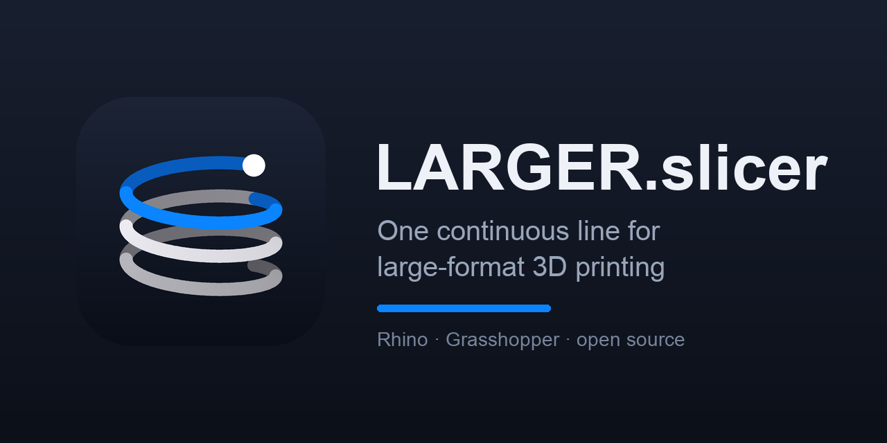
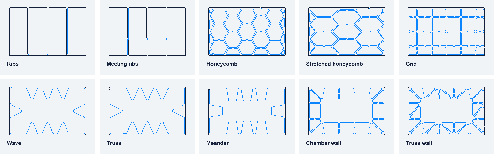
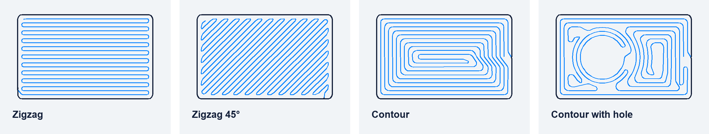

<div align="center">

<a href="https://parametricsolutions.de/de/larger-slicer/"></a>

# LARGER.slicer

**Modell rein. Eine Linie. Drucken.**<br>
Der Slicer für großformatigen 3D-Druck mit Roboter und Granulatextruder, in Rhino und Grasshopper.

[](https://github.com/Moeewe/LARGER.slicer/releases/latest) [](https://www.rhino3d.com/de/) [](#schnellstart) [](https://creativecommons.org/licenses/by-nc/4.0/deed.de)

<a href="https://github.com/Moeewe/LARGER.slicer/releases/latest/download/LARGERslicer-SETUP.zip"></a>

[Produktseite](https://parametricsolutions.de/de/larger-slicer/) · [Versionshinweise](https://github.com/Moeewe/LARGER.slicer/releases/latest) · [Dokumentation](LARGERslicer/documentations/README.md) · [Changelog](LARGERslicer/CHANGELOG.md)

[English](README.md) · **Deutsch**

</div>

---

## Eine Linie, vom Skirt bis zur letzten Lage

Ein Granulatextruder lässt sich nicht sauber stoppen: Jede Leerfahrt zieht Fäden, jeder Halt hinterlässt einen Tropfen. LARGER.slicer plant deshalb den ganzen Druck als **eine durchgehende Bahn** und prüft sie, bevor sie den Roboter erreicht.

| | |
|---|---|
| **Eine Linie** | Wände, Boden und Infill werden zu einer einzigen Bahn verbunden. Das Infill ist in die Wand eingebunden, nicht daneben gedruckt. |
| **Kreuzt sich nie** | Bei einer Kreuzung fährt die Düse durch frisch gelegtes Material. Lässt sich ein Muster nicht ohne Kreuzung drucken, wählt der Slicer ein anderes. |
| **Flache Lagen** | Jede Lage liegt flach. Zur nächsten Lage steigt die Bahn über eine kurze Rampe, immer an derselben Stelle. |
| **Aufgelegt** | Eine Bahn darf die darunter um höchstens eine halbe Bahnbreite überragen. `Path Check` meldet, wo ein Teil das überschreitet. |

## Infill aus einer Linie

Jede Zeichnung ist eine echte Lage aus dem Slicer (Bauteil 300 × 190 mm, Bahn 5 mm). Größe, Streckung, Winkel und Lage sind einstellbar.

<picture>
  <source media="(prefers-color-scheme: dark)" srcset="docs/readme-infill-dark.png">
  
</picture>

**Infill selbst zeichnen:** Kurven in der Draufsicht über das Bauteil zeichnen, und `Infill Sketch` macht aus jeder einen Steg, der ihr von Wand zu Wand folgt, als Teil derselben Linie.

## Böden ohne Absetzen

<picture>
  <source media="(prefers-color-scheme: dark)" srcset="docs/readme-bottom-dark.png">
  
</picture>

## Der Tab „Slicer“

Neu hier? `Easy Slicer` ist ein einzelner Baustein vom Modell bis zur geprüften Druckbahn; die Seite [Erste Schritte](https://parametricsolutions.de/larger-slicer/erste-schritte/) führt hindurch. Die Komponenten werden in dieser Reihenfolge verbunden. `Quick Start` legt die ganze Kette samt Beispielteil auf die Leinwand.

| Schritt | Komponente | Aufgabe |
|---|---|---|
| 1 | `Machine Profile` | Wie dein Drucker die Extrusionswerte erwartet: Volumen, Filamentlänge oder Faktor für die Steuerung |
| 2 | `Print Settings` | Bahnbreite, Lagenhöhe, Überlappung, Geschwindigkeit, kleinster Radius |
| 3 | `Slice` | Breps, Flächen, SubDs, Meshes. Flach, gekippt, non-planar (Führungsfläche) oder multiaxial (Führungskurve) |
| 4 | `Walls` | Bahn innen, mittig oder außen an der Geometrie |
| 5 | `Bottom Fill` | Geschlossener Boden als eine Linie: Zickzack oder Kontur |
| 6 | `Infill Ribs` · `Infill Sketch` · `Infill Cells` · `Infill Wave` · `Infill Chambers` | Infill, in die Wandlinie eingebunden |
| 7 | `Continuous Path` | Flache Lagen mit kurzer Rampe an fester Naht, oder Spirale für einfache Wände |
| 8 | `Round Corners` | Jede Ecke wird ein Bogen |
| 9 | `Start and End` | Skirt zuerst, am Ende vom Bauteil wegfahren |
| 10 | `Path Check` | Auflage, Selbstkreuzung, Bahnform, Leerfahrten |
| 11 | `Extrusion and Speed` | Ebene, E und F pro Punkt für DXR Generator oder G-Code |
| | `Desktop Test Print` | Derselbe Pfad verkleinert als G-Code für einen Filamentdrucker |
| | `Ginger G-code` | Der Pfad in Originalgröße als G-Code für den Ginger One, mit dessen Start- und End-Sequenz |

## Der Tab „Robot“

Für das Drucken mit dem Roboter: Die Zelle wird einmal beschrieben, danach wird jede Bahn zu Roboterbewegungen mit der echten Werkzeugorientierung.

| Baustein | Was er macht |
|---|---|
| `Robot` | Der Arm. Voreingestellt ist der KUKA KR120 R2700-2; jeder Sechsachser mit Zentralhand lässt sich aus einer Bibliotheksdatei des Robots-Plug-ins (.xml) laden |
| `Robot Tool` | Werkzeugspitze (TCP, relativ zum Flansch) und Gewicht |
| `Robot Cell` | Roboter, Werkzeug und die Basis, von der aus das Programm zählt (KUKA `$BASE`) |
| `Robot Program` | Werkzeugspitze auf jedem Bahnpunkt, Werkzeug entlang der Werkzeugachse der Bahn. Prüft Reichweite, Achsbereiche, Handachsen-Singularität und Achsgeschwindigkeit. Gibt die Bewegungen für den `DXR Generator`, ein KRL-Programm und den Arm an jeder Stelle der Bahn aus |

Die kurvenbasierten Werkzeuge des früheren Tabs „Toolpaths“ liegen jetzt unter **Slicer Curves** und heißen wie ihre Gegenstücke im Slicer (`Curve Fill Zigzag`, `Curve Fill Contour`, `Curve Fill Cells`, `Curve Continuous Path`, `Curve Uncross` ...).

## Maschinen

| | |
|---|---|
| **Im Einsatz erprobt** | Weber Additive DXR25 (KUKA-Roboter, DXR-Code) · Ginger Additive Ginger One (G-Code) |
| **Testdrucke im kleinen Maßstab** | Bambu Lab, Prusa, Creality, Elegoo und andere Marlin- oder Klipper-Drucker, über `Desktop Test Print` |
| **Andere Granulat- und Robotersysteme** | Nicht getestet. Das allgemeine Granulat-Profil gibt Position, Werkzeugachse, E und F pro Punkt aus; Format der Steuerung und Extrusionsfaktor müssen an der Maschine abgeglichen werden. |

Alle genannten Marken gehören ihren jeweiligen Inhabern. LARGER.slicer ist ein unabhängiges Projekt und steht in keiner Verbindung zu diesen Herstellern.

## Außerdem im Paket

- **Eine Grasshopper-Definition, drei Arbeitsabläufe** – *Easy Slicer* schneidet Flächen automatisch, *Path Creator (multiaxial)* macht aus vorbereiteten Werkzeugbahnen Roboterbahnen, *Custom Paths* exportiert eigene Bahnen als Robotercode.
- **Robotercode für den Weber DXR25 (KUKA)** – DXR-Generator und G-Code → DXR-Postprozessor mit automatischem Header (Laufzeit, Schichten, Extrusionssummen) und Zeilennummerierung.
- **Variable Bahnbreiten** – `DXR Variable Width` skaliert die Extrusion entlang X, Y oder Z, mit farbiger Breitenvorschau.
- **Prüfung vor dem Druck** – `DXR File Health Check` prüft Dateiname, Lesbarkeit und Inhalt (GO / NO GO).
- **CNC-Werkzeugbahnen** – Zickzack-Bahnen (Boustrophedon) mit HPGL/PLT-Ausgabe für die Zünd G3.
- **Einrichtung per Doppelklick** – der Installer richtet alle Plugins und die KUKA-KR120-Roboterbibliothek unter Windows und macOS ein.
- **Maschinenanleitungen** – Bedien- und Fehlerbehebungsanleitungen für jede unterstützte Maschine (Deutsch und Englisch).

## Download

📥 **[LARGERslicer-SETUP.zip](https://github.com/Moeewe/LARGER.slicer/releases/latest/download/LARGERslicer-SETUP.zip)** – immer die neueste Version.
Enthält die Grasshopper-Definition, den Installer für Windows und macOS und die KUKA-KR120-Roboterbibliothek.

🧩 **Nur das Plugin:** im Rhino Package Manager (Befehl `PackageManager` bzw. `PaketManager`) nach **LARGERslicer** suchen.

## Schnellstart

**Voraussetzungen:** Rhino 8 (empfohlen) oder Rhino 7 · Windows 11 oder macOS 11+ · Internetverbindung während der Einrichtung

1. **[LARGERslicer-SETUP.zip](https://github.com/Moeewe/LARGER.slicer/releases/latest/download/LARGERslicer-SETUP.zip)** herunterladen und entpacken.
2. Rhino schließen und den Installer im Ordner `SETUP` starten:

   | Windows | macOS |
   |---|---|
   | Doppelklick auf `Install Windows.bat` | Rechtsklick auf `Install Mac.command` → **Öffnen** → **Öffnen** |

3. Rhino starten, eine Datei in **Millimetern** anlegen, Grasshopper öffnen und `LARGERslicer Weber Robot and Ginger.gh` aus dem Ordner `SETUP` öffnen.

Der Installer installiert **Robots**, **LARGERslicer** und **Pufferfish** über den Rhino Package Manager und kopiert die KUKA-KR120-Roboterbibliothek (`KR120_R2700_2`) in den Ordner, den das Robots-Plugin liest. Er kann jederzeit erneut ausgeführt werden und aktualisiert dann nur, was veraltet ist.

<details>
<summary><b>Details zum Installer und Fehlerbehebung</b></summary>

- **Vorhandene Installationen:** aktuelle Plugins bleiben unverändert, ältere werden aktualisiert, neuere (z. B. Beta-Versionen) bleiben erhalten.
- **Alte manuelle Installationen:** `.gha`-Dateien, die von Hand in den Grasshopper-Libraries-Ordner kopiert wurden, werden erkannt und können in einen Backup-Ordner verschoben werden (sonst werden Komponenten doppelt geladen).
- **Roboterbibliothek:** eine abweichende vorhandene Datei wird als `*.bak-<Datum>` gesichert, bevor sie ersetzt wird.
- **macOS blockiert den Installer** („nicht verifizierter Entwickler“): Rechtsklick auf `Install Mac.command` → **Öffnen**.
- **Robotersystem `KR120_R2700_2` fehlt:** Installer erneut ausführen oder in der Komponente *Load Robot System* auf **Libraries** klicken und die Online-Bibliothek **FH Muenster MSA** herunterladen.
- **Rhino 7:** erhält Robots 1.9 (Robots 2.x benötigt Rhino 8). Die Definition ist mit Rhino 8 getestet.
- **Plugin-Version festlegen:** im Installer oben in der Liste `PACKAGES` die Version hinter den Paketnamen schreiben, z. B. `"Robots 2.4.4"`.

Mehr: [SETUP-Anleitung](SETUP/README.de.md)

</details>

## Unterstützte Maschinen

| Maschine | Art | Grasshopper-Definition | Anleitung |
|---|---|---|---|
| **Weber DXR25** | KUKA-Roboter, multiaxial | `LARGERslicer Weber Robot and Ginger.gh` | [Deutsch](<EXAMPLE FILES/00 - WEBER - GINGER [Robotic] 3D Printing/00 - WEBER - DXR25 - README/README Weber DXR25 PRINTER QUICK START GUIDE GERMAN.md>) · [English](<EXAMPLE FILES/00 - WEBER - GINGER [Robotic] 3D Printing/00 - WEBER - DXR25 - README/README Weber DXR25 PRINTER QUICK START GUIDE ENGLISH.md>) |
| **Ginger One** | Großformat-Granulatdrucker | `LARGERslicer Weber Robot and Ginger.gh` | [Schnellstart (Englisch)](<EXAMPLE FILES/00 - WEBER - GINGER [Robotic] 3D Printing/00 - GINGER - ONE - README/README GINGER 00 QUICK START GUIDE.md>) |
| **Universal Robots UR5** | Kollaborativer Roboter | `UR5slicer.gh` | [Schnellstart (Englisch)](<EXAMPLE FILES/00 - UNIVERSAL ROBOTS - UR5/README UR5 00 QUICK START GUIDE.md>) |
| **Zünd G3 L-2500** | CNC-Fräsen / Schneiden | `ZündHGPL PLT MSA.gh` | [Schnellstart (Englisch)](<EXAMPLE FILES/00 - ZUENDT - 3D CNC MILLING/README Zünd G3 L-2500 CNC MILLING QUICK START GUIDE.md>) |

## Bedienung

`LARGERslicer Weber Robot and Ginger.gh` enthält drei Arbeitsabläufe – den benötigten in eine neue Grasshopper-Datei kopieren:

1. **Easy Slicer** – schneidet Flächen und erzeugt die Werkzeugbahn automatisch.
2. **Path Creator (multiaxial)** – wandelt eine vorbereitete Werkzeugbahn in multiaxiale Roboterbahnen um.
3. **Custom Paths** – nutzt nur die Umwandlungs- und Export-Komponenten, um aus eigenen Bahnen DXR-Robotercode zu erzeugen.

Passwortgeschützte Cluster: Rechtsklick auf die Komponente und **Supersizedprinting** eingeben.

<details>
<summary><b>Teil 1: 3D Print Path Maker</b></summary>

1. **Eingangsgeometrie:** Rechtsklick auf **Set One Surface** → Fläche auswählen.
2. **Skirt / Brim:** mit den True/False-Schaltern ein- oder ausschalten.
3. **Parameter:**
   - **Corner Fillet Radius (mm)** – rundet Ecken ab
   - **Min/Max Extrusion Width (mm)** – Standard- und adaptive Breite
   - **Layer Height (mm)** – Schichthöhe
   - **Point Spacing (mm)** – Punktabstand (Standard 2–5 mm)

**Ergebnis:** Werkzeugbahnen entlang der Mittellinie jeder Schicht.

</details>

<details>
<summary><b>Teil 2: G-Code- / DXR-Erstellung</b></summary>

1. **Vorschau:** mit dem **Preview Slider (0 → 1)** durch die Werkzeugbahn fahren.
2. **Druckerprofil:** **Ginger One** oder **Weber DXR** wählen (UR5: `UR5slicer.gh` verwenden).
3. **Prüfung:** die Datei mit **DXR File Health Check** prüfen und nur bei **GO** weitermachen.
4. **Speicherort:** den integrierten Desktop-Pfad oder einen eigenen Dateipfad verwenden.
5. **Einstellungen:** Auftragsname, Vorschub / Geschwindigkeit, Flow (%).

**Export in zwei Schritten:**

1. **1. Slice Data** klicken – berechnet Gewicht, Zeit und Koordinaten.
2. **2. Export G-Code** klicken – schreibt die Datei.

Ohne *Slice Data* wird nur der Standard-Start-/Endcode geschrieben – ohne Koordinaten, Gewicht und Zeit.

**Ausgaben:** Gewicht (kg), Druckzeit, maschinenfertiger Code.

</details>

## Dokumentation

| Thema | Link |
|---|---|
| Übersicht aller Anleitungen | [Dokumentationsindex](LARGERslicer/documentations/README.md) |
| Maschine bedienen | [Maschinenanleitungen](LARGERslicer/documentations/README.md#machine-guides) |
| KUKA-/DXR25-Roboterfehler | [Deutsch](LARGERslicer/documentations/KUKA_ROBOT_TROUBLESHOOTING_DE.md) · [English](LARGERslicer/documentations/KUKA_ROBOT_TROUBLESHOOTING.md) |
| Plugin-Komponenten | [Komponentenübersicht](LARGERslicer/documentations/COMPONENTS_OVERVIEW.md) · [Ein-/Ausgänge](LARGERslicer/documentations/COMPONENT_INPUTS_OUTPUTS.md) |
| Neuerungen | [Changelog](LARGERslicer/CHANGELOG.md) |

## Fehlerbehebung

| Problem | Lösung |
|---|---|
| Plugin-Komponenten fehlen oder sind rot | Installer erneut ausführen, danach Rhino neu starten |
| Robotersystem `KR120_R2700_2` fehlt | Installer erneut ausführen oder über **Libraries** in *Load Robot System* die Online-Bibliothek **FH Muenster MSA** laden |
| Fläche wird nicht angenommen | **Set One Surface** mit einer gültigen Brep-Fläche verwenden |
| G-Code-Datei erscheint nicht | **Export G-Code** klicken und Speicherpfad prüfen |
| DXR File Health Check meldet **NO GO** | Dateiname / Pfad korrigieren, erneut exportieren und prüfen, bis **GO** erscheint |
| Vorschau-Slider ohne Funktion | Verbindung am Eingang **Path Preview** prüfen |
| DXR25: Roboter nicht justiert / externe Achse E1 (KSS01347, KSS00106, KSS15047) | [Roboter nicht justiert (E1)](LARGERslicer/documentations/KUKA_ROBOT_TROUBLESHOOTING_DE.md#problem-roboter-nicht-justiert-e1) – ein Programm-Reset allein hilft nicht |
| DXR25: Bremstest / Startbewegung beginnt nicht | [Bremstest / Startbewegung](LARGERslicer/documentations/KUKA_ROBOT_TROUBLESHOOTING_DE.md#problem-roboter-führt-bremstest--startbewegung-nach-dem-start-nicht-aus) |
| DXR25: Notstopp nahe Sicherheitszaun | [Notstopp am Sicherheitszaun](LARGERslicer/documentations/KUKA_ROBOT_TROUBLESHOOTING_DE.md#problem-notstop-nahe-sicherheitszaun-multiaxialer-druck) |
| DXR25: Roboter bewegt sich nicht / Referenzfahrt startet nicht | [Roboter reagiert nicht](LARGERslicer/documentations/KUKA_ROBOT_TROUBLESHOOTING_DE.md#problem-roboter-reagiert-nicht--start--referenz--oder-justagefahrt-wird-nicht-ausgeführt) |

> [!TIP]
> **Multiaxiale Drucke mit 45°:** den Extruder zur Wand bzw. zur größten freien Fläche neigen, nicht zur Sicherheitstür, und zusätzlichen Abstand zum Zaun halten – die Bremszone beginnt etwa 10–15 cm vor der eigentlichen Absperrung.

## Entwicklung

<details>
<summary><b>Aufbau des Repositories</b></summary>

```
LARGER.slicer/
├── SETUP/                     # Hier starten: Installer, Weber/Ginger-Definition, Roboterbibliothek
├── LARGERslicer/              # Grasshopper-Plugin (C#)
│   ├── Components/            # CNC-, Export- und Utility-Komponenten
│   ├── Resources/             # Komponenten-Icons
│   ├── documentations/        # Anleitungen und Referenzen
│   └── build-package.sh/.bat  # Baut die Yak-Pakete für Rhino 7, 8 und 9
└── EXAMPLE FILES/             # Maschinenspezifische Definitionen und Anleitungen
    ├── 00 - UNIVERSAL ROBOTS - UR5/
    ├── 00 - WEBER - GINGER [Robotic] 3D Printing/
    └── 00 - ZUENDT - 3D CNC MILLING/
```

</details>

**Plugin bauen:**

```bash
cd LARGERslicer
./build-package.sh          # unter Windows build-package.bat; optional neue Version, z. B. 1.1.14
```

Erzeugt `dist/largerslicer-<version>-rh9_0-any.yak`, `dist/largerslicer-<version>-rh8_0-any.yak` und `dist/largerslicer-<version>-rh7_0-any.yak`. Mehr: [Plugin-README](LARGERslicer/README.md).

## Lizenz

© 2025 Moritz Wesseler, FH Münster · Lizenziert unter [CC BY-NC 4.0](https://creativecommons.org/licenses/by-nc/4.0/deed.de) – nur für nicht-kommerzielle Nutzung.

Mitwirkende: Fabio Koczula, Claudio Schröder · Ursprünglich inspiriert von Ginger.Additive, vollständig neu umgesetzt und um weitere Maschinen erweitert.
