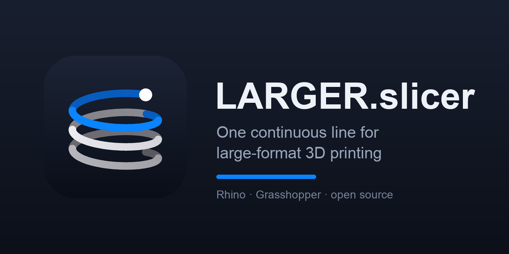
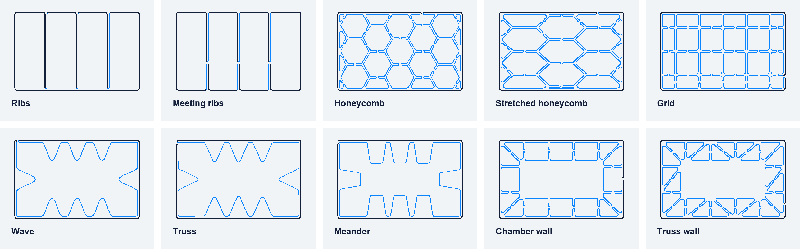
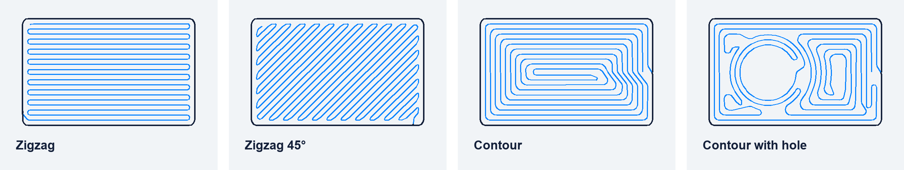

<div align="center">

<a href="https://parametricsolutions.de/larger-slicer/"></a>

# LARGER.slicer

**Model in. One line. Print.**<br>
The slicer for large-format 3D printing with robots and pellet extruders, in Rhino and Grasshopper.

[](https://github.com/Moeewe/LARGER.slicer/releases/latest) [](https://www.rhino3d.com/) [](#quick-start) [](https://creativecommons.org/licenses/by-nc/4.0/)

<a href="https://github.com/Moeewe/LARGER.slicer/releases/latest/download/LARGERslicer-SETUP.zip"></a>

[Product page](https://parametricsolutions.de/larger-slicer/) · [Release notes](https://github.com/Moeewe/LARGER.slicer/releases/latest) · [Documentation](LARGERslicer/documentations/README.md) · [Changelog](LARGERslicer/CHANGELOG.md)

**English** · [Deutsch](README.de.md)

</div>

---

## One line, from skirt to last layer

A pellet extruder cannot stop cleanly: every travel move pulls strings and every halt leaves a blob. LARGER.slicer therefore plans the whole print as **one continuous path** and checks it before it reaches the robot.

| | |
|---|---|
| **One line** | Walls, bottom and infill are joined into a single path. Infill is spliced into the wall, not printed beside it. |
| **Never crosses itself** | A crossing means the nozzle ploughs through fresh material. If a pattern cannot be printed without one, the slicer picks another. |
| **Flat layers** | Every layer lies flat. The seam stays open by one bead width; the path crosses the gap on a short incline to the next layer, always in the same place. |
| **Supported** | A bead may overhang the one below by half a bead width at most. `Path Check` reports where a part exceeds that. |

## Infill from one line

Every drawing is a real layer from the slicer (part 300 × 190 mm, bead 5 mm). Size, stretch, angle and position are adjustable.

<picture>
  <source media="(prefers-color-scheme: dark)" srcset="docs/readme-infill-dark.png">
  
</picture>

**Draw your own infill:** sketch curves over the part in top view and `Infill Sketch` turns each one into a rib that follows it from wall to wall, as part of the same line.

## Bottoms without stopping

<picture>
  <source media="(prefers-color-scheme: dark)" srcset="docs/readme-bottom-dark.png">
  
</picture>

## The Slicer tab

New here? `Easy Slicer` is one component from the model to the checked print path; the [first-steps page](https://parametricsolutions.de/larger-slicer/erste-schritte/) walks through it. For every option, components connect in this order; `Quick Start` places the whole chain with example parts.

Settings sit on the components themselves: the rows under a component are choices, numbers, switches and buttons (`Save G-code`, `Play`). Click a row to change it; a wire into the same input still wins.

| Step | Component | What it does |
|---|---|---|
| 1 | `Machine Profile` | How your printer wants its extrusion values: volume, filament length, or a factor for the controller |
| 2 | `Print Settings` | Bead width, layer height, overlap, speed, minimum radius |
| 3 | `Slice` | Breps, surfaces, SubDs, meshes. Flat, tilted, non-planar (guide surface) or multi-axis (guide curve) |
| 4 | `Walls` | Bead inside, centred on or outside the geometry |
| 5 | `Bottom Fill` | Closed bottom as one line: zigzag or contour |
| 6 | `Infill Ribs` · `Infill Sketch` · `Infill Cells` · `Infill Wave` · `Infill Chambers` | Infill spliced into the wall path |
| 7 | `Continuous Path` | Flat layers with an open seam (gap of one bead width) at a fixed place, or a spiral for single walls |
| 8 | `Round Corners` | Every corner becomes an arc |
| 9 | `Start and End` | Way in from 30 mm above, skirt first, brim outside, inside or both, a move off the part at the end |
| 10 | `Path Check` | Support, self-crossings, bead shape, travel moves |
| 11 | `Extrusion and Speed` | Plane, E and F per point for the DXR Generator or G-code |
| | `Desktop Test Print` | The same path scaled down as G-code for a desktop filament printer |
| | `Ginger G-code` | The path in full size as G-code for the Ginger One, with its start and end sequence |
| | `Machine` · `Machine G-code` | Your own G-code machine: start, layer and end code and E factor as a `.machine` file in Documents/LARGER/Machines |

## The Robot tab

For printing with a robot: the cell is described once, then every toolpath becomes robot moves with the real tool orientation.

| Component | What it does |
|---|---|
| `Robot` | The arm. KUKA KR120 R2700-2 by default; any six-axis arm with a spherical wrist from a Robots plug-in library file (.xml) |
| `Robot Tool` | Tool centre point as in the Robots plug-in (AE20 extruder: YZ plane at -460, 3, 108), weight, centre of mass, 3D model |
| `Robot Cell` | Robot, tool and the work base the program counts from (KUKA `$BASE`) |
| `Robot Program` | Tool tip on every path point, tool along the path's tool axis. Checks reach, axis ranges, wrist singularity and axis speed. Outputs the moves for the `DXR Generator`, a KRL program and the arm at any place of the path |
| `Robot Simulation` | Plays the program: the robot with its tool at any moment of the print (slider or Play) |
| `Cell Geometry` | The print cell of the FH Muenster in 3D (floor, pedestal, bed, fence), the place of the robot, and the environment for the collision check |

The curve-based tools of the former Toolpaths tab are now in **Slicer Curves**, named like their Slicer counterparts (`Curve Fill Zigzag`, `Curve Fill Contour`, `Curve Fill Cells`, `Curve Continuous Path`, `Curve Uncross` ...).

## Machines

File names follow the FH Muenster: `DXR_2611051216_Test Object_2668g_53min.dxr` - machine, date and time, part, weight, print time. A vertical extruder is written as A 0, B 0, C 0, as the Weber DXR expects.

| | |
|---|---|
| **Proven in use** | Weber Additive DXR25 (KUKA robot, DXR code) · Ginger Additive Ginger One (G-code) |
| **Scaled test prints** | Bambu Lab, Prusa, Creality, Elegoo and other Marlin or Klipper printers, via `Desktop Test Print` |
| **Other pellet and robot systems** | Not tested. The generic pellet profile outputs position, tool axis, E and F per point; controller format and extrusion factor have to be matched on the machine. |

### 45-degree printing

- **Before modelling:** `Design Rules` gives layer height range, overlap, how thick to model a wall of two beads (CO90, and CO45 where the layers cross it at 45 degrees), the layer width for a finished wall thickness (LW45) and the start and end feature, after the CEAD sheets and the Ginger handbook.
- **Slicing:** `Slice` with `Angle` 45.
- **One line:** `Continuous Path` joins contours that lie inside each other (inner and outer shell, openings) with a bridge of two lines that stacks into a rib on every layer, after the Continuous-Toolpath Connection Rule (Wesseler, Herrlein, Kiendl).

### Your own machine or print cell

No code is needed. Everything is a text file or a Rhino file in `Documents/LARGER`:

| What | Where | How |
|---|---|---|
| G-code machine | `Machines/My printer.machine` | Start, layer and end code, bed size and E factor as text (see `Machine`). Easiest: type them into `Machine` and set `Save`. |
| Its 3D model for the preview | `Machines/My printer.3dm` | Draw frame, bed and gantry in Rhino in the machine's coordinates (its 0, 0, 0 at the origin), or connect them to `Model` of `Machine` and set `Save`. Without a model the bed is drawn from the bed size. |
| Robot print cell | `Cells/My cell.3dm` | Draw it in millimetres in the coordinates of the bed, one part per layer: `Bed` (drawn, not checked for collisions), `Robot Base` (a point where the robot stands and a line from it along its X axis), `Work Base` (optional), and any other layer (Floor, Fence, Table ...) for the collision check. Set `Export` on `Cell Geometry` to get the cell of the FH Muenster in this form as a start. |
| Robot arm | `Documents/RobotSystems` | The library of the Robots plug-in; `Robot` reads the arm and its 3D model from there (`Geometry File`). |
| Tool | `Robot Tool` | TCP plane, weight and centre of mass as in Robots; connect your extruder as a mesh to `Mesh`. |

New files appear in the lists of `Machine` and `Cell Geometry` the next time they are placed. Pass the folder on as it is: the `.3dm` next to a `.machine` file is found by its name.

All brands named belong to their respective owners. LARGER.slicer is an independent project and is not affiliated with these manufacturers.

## Also in the package

- **One Grasshopper definition, three workflows** – *Easy Slicer* slices surfaces automatically, *Path Creator (multiaxial)* turns prepared toolpaths into robot paths, *Custom Paths* exports your own paths as robot code.
- **Robot code for Weber DXR25 (KUKA)** – DXR Generator and G-code → DXR postprocessor with automatic header (runtime, layers, extrusion totals) and line numbering.
- **Variable line widths** – `DXR Variable Width` scales the extrusion along X, Y or Z with a colored width preview.
- **Preflight safety** – `DXR File Health Check` validates file name, readability and content before printing, and fails any move with feed rate 0.
- **CNC toolpaths** – zigzag (boustrophedon) toolpaths with HPGL/PLT output for the Zünd G3.
- **One-click setup** – the installer sets up all plugins and the KUKA KR120 robot library on Windows and macOS.
- **Machine guides** – operating and troubleshooting guides for every supported machine (German and English).

## Download

📥 **[LARGERslicer-SETUP.zip](https://github.com/Moeewe/LARGER.slicer/releases/latest/download/LARGERslicer-SETUP.zip)** – always the latest release.
Contains the Grasshopper definition, the installer for Windows and macOS and the KUKA KR120 robot library.

🧩 **Plugin only:** search for **LARGERslicer** in the Rhino Package Manager (`PackageManager` command).

## Quick Start

**Requirements:** Rhino 8 (recommended) or Rhino 7 · Windows 11 or macOS 11+ · internet connection during setup

1. Download **[LARGERslicer-SETUP.zip](https://github.com/Moeewe/LARGER.slicer/releases/latest/download/LARGERslicer-SETUP.zip)** and unzip it.
2. Close Rhino and run the installer in the `SETUP` folder:

   | Windows | macOS |
   |---|---|
   | Double-click `Install Windows.bat` | Right-click `Install Mac.command` → **Open** → **Open** |

3. Start Rhino, create a file in **millimeters**, open Grasshopper and open `LARGERslicer Weber Robot and Ginger.gh` from the `SETUP` folder.

The installer installs **Robots**, **LARGERslicer** and **Pufferfish** from the Rhino Package Manager and copies the KUKA KR120 robot library (`KR120_R2700_2`) to the folder the Robots plugin reads. It can be run again at any time and then only updates what is outdated.

<details>
<summary><b>Installer details and troubleshooting</b></summary>

- **Existing installations:** current plugins are kept, older ones are updated, newer ones (e.g. beta builds) are kept.
- **Old manual installations:** `.gha` files copied into the Grasshopper Libraries folder are detected and can be moved to a backup folder (otherwise components load twice).
- **Robot library:** a differing existing file is saved as `*.bak-<date>` before it is replaced.
- **macOS blocks the installer** (“unidentified developer”): right-click `Install Mac.command` → **Open**.
- **Robot system `KR120_R2700_2` missing:** run the installer again, or click **Libraries** on the *Load Robot System* component and download the online library **FH Muenster MSA**.
- **Rhino 7:** gets Robots 1.9 (Robots 2.x requires Rhino 8). The definition is tested in Rhino 8.
- **Pin a plugin version:** add the version after the package name in the `PACKAGES` list at the top of the installer, e.g. `"Robots 2.4.4"`.

More: [SETUP guide](SETUP/README.md)

</details>

## Supported Machines

| Machine | Type | Grasshopper definition | Guide |
|---|---|---|---|
| **Weber DXR25** | KUKA robot, multiaxial | `LARGERslicer Weber Robot and Ginger.gh` | [English](<EXAMPLE FILES/00 - WEBER - GINGER [Robotic] 3D Printing/00 - WEBER - DXR25 - README/README Weber DXR25 PRINTER QUICK START GUIDE ENGLISH.md>) · [Deutsch](<EXAMPLE FILES/00 - WEBER - GINGER [Robotic] 3D Printing/00 - WEBER - DXR25 - README/README Weber DXR25 PRINTER QUICK START GUIDE GERMAN.md>) |
| **Ginger One** | Large-format pellet printer | `LARGERslicer Weber Robot and Ginger.gh` | [Quick Start](<EXAMPLE FILES/00 - WEBER - GINGER [Robotic] 3D Printing/00 - GINGER - ONE - README/README GINGER 00 QUICK START GUIDE.md>) |
| **Universal Robots UR5** | Collaborative robot | `UR5slicer.gh` | [Quick Start](<EXAMPLE FILES/00 - UNIVERSAL ROBOTS - UR5/README UR5 00 QUICK START GUIDE.md>) |
| **Zünd G3 L-2500** | CNC milling / cutting | `ZündHGPL PLT MSA.gh` | [Quick Start](<EXAMPLE FILES/00 - ZUENDT - 3D CNC MILLING/README Zünd G3 L-2500 CNC MILLING QUICK START GUIDE.md>) |

## Usage Guide

`LARGERslicer Weber Robot and Ginger.gh` contains three workflows – copy the one you need into a new Grasshopper file:

1. **Easy Slicer** – slices surfaces and creates the toolpath automatically.
2. **Path Creator (multiaxial)** – converts a prepared toolpath into multiaxial robot paths.
3. **Custom Paths** – uses only the conversion/export components to create DXR robot code from your own paths.

Password-protected clusters: right-click the component and enter **Supersizedprinting**.

<details>
<summary><b>Part 1: 3D Print Path Maker</b></summary>

1. **Input geometry:** right-click **Set One Surface** → pick your surface.
2. **Skirt / Brim:** set them in the rows under `Start and End` (click a row for its choices).
3. **Parameters:**
   - **Corner Fillet Radius (mm)** – rounds off corners
   - **Min/Max Extrusion Width (mm)** – standard and adaptive widths
   - **Layer Height (mm)** – Z step
   - **Point Spacing (mm)** – point interval (default 2–5 mm)

**Output:** toolpath curves along the midline of each layer.

</details>

<details>
<summary><b>Part 2: G-Code / DXR Maker</b></summary>

1. **Preview:** scrub through the toolpath with the **Preview Slider (0 → 1)**.
2. **Printer profile:** choose **Ginger One** or **Weber DXR** (UR5: use `UR5slicer.gh`).
3. **Preflight check:** validate the file with **DXR File Health Check** and continue only on **GO**.
4. **Output location:** use the integrated desktop path or your own file path.
5. **Settings:** job name, feedrate / speed, flow (%).

**Export in two steps:**

1. Click **1. Slice Data** – calculates weight, time and coordinates.
2. Click **2. Export G-Code** – writes the file.

If you skip *Slice Data*, only the standard start/end code is written – without coordinates, weight or time.

**Outputs:** weight (kg), print time, machine-ready code.

</details>

## Documentation

| Topic | Link |
|---|---|
| Overview of all guides | [Documentation index](LARGERslicer/documentations/README.md) |
| Operate a machine | [Machine guides](LARGERslicer/documentations/README.md#machine-guides) |
| KUKA / DXR25 robot errors | [English](LARGERslicer/documentations/KUKA_ROBOT_TROUBLESHOOTING.md) · [Deutsch](LARGERslicer/documentations/KUKA_ROBOT_TROUBLESHOOTING_DE.md) |
| Plugin components | [Component overview](LARGERslicer/documentations/COMPONENTS_OVERVIEW.md) · [Inputs/outputs](LARGERslicer/documentations/COMPONENT_INPUTS_OUTPUTS.md) |
| What's new | [Changelog](LARGERslicer/CHANGELOG.md) |

## Troubleshooting

| Problem | Solution |
|---|---|
| Plugin components missing or red | Run the installer again, then restart Rhino |
| Robot system `KR120_R2700_2` missing | Run the installer again, or download the **FH Muenster MSA** online library via **Libraries** on *Load Robot System* |
| Surface not accepted | Use **Set One Surface** with a valid Brep surface |
| G-code file does not appear | Click **Export G-Code** and check the save path |
| DXR File Health Check returns **NO GO** | Fix file name / path, export again and check until **GO** |
| Preview slider inactive | Check the **Path Preview** input wiring |
| DXR25: robot not mastered / external axis E1 (KSS01347, KSS00106, KSS15047) | [Robot Not Mastered (E1)](LARGERslicer/documentations/KUKA_ROBOT_TROUBLESHOOTING.md#issue-robot-not-mastered-e1) – a program reset alone does not help |
| DXR25: brake test / start movement does not begin | [Brake test / start movement](LARGERslicer/documentations/KUKA_ROBOT_TROUBLESHOOTING.md#issue-robot-does-not-perform-brake-test--start-movement-after-startup) |
| DXR25: emergency stop near the safety fence | [Emergency stop near safety fence](LARGERslicer/documentations/KUKA_ROBOT_TROUBLESHOOTING.md#issue-emergency-stop-triggered-near-safety-fence-multiaxial-printing) |
| DXR25: robot does not move / reference run does not start | [Robot does not move](LARGERslicer/documentations/KUKA_ROBOT_TROUBLESHOOTING.md#issue-robot-does-not-move--start-reference-or-calibration-run-cannot-be-executed) |

> [!TIP]
> **45° multiaxial prints:** tilt the extruder toward the wall or the largest free area, not toward the safety door, and keep extra clearance from the fence – the braking zone starts about 10–15 cm before the physical barrier.

## Development

<details>
<summary><b>Repository structure</b></summary>

```
LARGER.slicer/
├── SETUP/                     # Start here: installer, Weber/Ginger definition, robot library
├── LARGERslicer/              # Grasshopper plugin (C#)
│   ├── Components/            # CNC, Export and Utility components
│   ├── Resources/             # Component icons
│   ├── documentations/        # Guides and references
│   └── build-package.sh/.bat  # Builds the Rhino 7, 8 and 9 Yak packages
└── EXAMPLE FILES/             # Machine-specific definitions and guides
    ├── 00 - UNIVERSAL ROBOTS - UR5/
    ├── 00 - WEBER - GINGER [Robotic] 3D Printing/
    └── 00 - ZUENDT - 3D CNC MILLING/
```

</details>

**Build the plugin:**

```bash
cd LARGERslicer
./build-package.sh          # or build-package.bat on Windows; optional: new version, e.g. 1.1.14
```

Creates `dist/largerslicer-<version>-rh9_0-any.yak`, `dist/largerslicer-<version>-rh8_0-any.yak` and `dist/largerslicer-<version>-rh7_0-any.yak`. More: [Plugin README](LARGERslicer/README.md).

## License

© 2025 Moritz Wesseler, FH Münster · Licensed under [CC BY-NC 4.0](https://creativecommons.org/licenses/by-nc/4.0/) – non-commercial use only.

Contributors: Fabio Koczula, Claudio Schröder · Originally inspired by Ginger.Additive, fully reimplemented with expanded machine support.

## Safety and disclaimer

Robot and machine programs made with LARGER.slicer are not verified. Before every run, check them in T1 or test mode at reduced speed; collisions, axis limits, singularities and temperatures are the operator's responsibility. Only trained people may run the machines, following the operating instructions of the cell and the manufacturers (KUKA, Weber and others). No warranty, as far as the law allows. Third-party licences, sources and trademarks: see [THIRD_PARTY_NOTICES.md](THIRD_PARTY_NOTICES.md).
