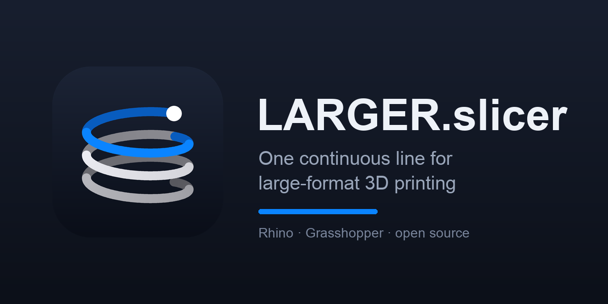
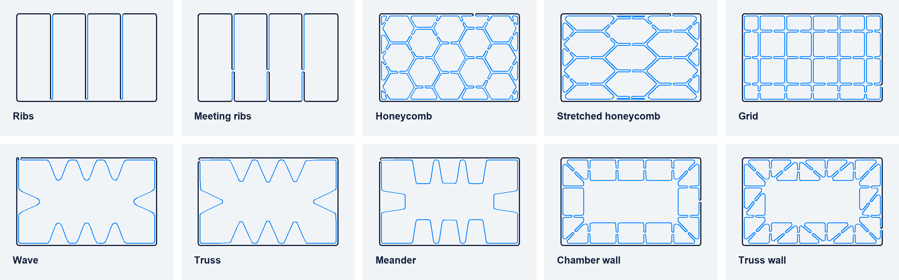
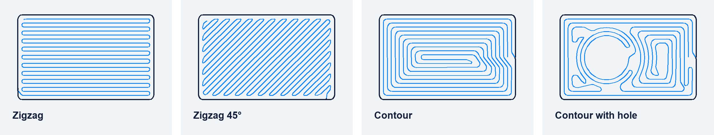

<div align="center">

<a href="https://parametricsolutions.de/larger-slicer/"></a>

# LARGER.slicer

**Model in. One line. Print.**<br>
The slicer for large-format 3D printing with robots and pellet extruders, in Rhino and Grasshopper.

[](https://github.com/Moeewe/LARGER.slicer/releases/latest) [](https://www.rhino3d.com/) [](#quick-start) [](https://creativecommons.org/licenses/by-nc/4.0/)

<a href="https://github.com/Moeewe/LARGER.slicer/releases/latest/download/LARGERslicer-SETUP.zip"></a>

[Product page](https://parametricsolutions.de/larger-slicer/) · [Release notes](https://github.com/Moeewe/LARGER.slicer/releases/latest) · [Documentation](LARGERslicer/documentations/README.md) · [Changelog](LARGERslicer/CHANGELOG.md)

**English** · [Deutsch](README.de.md)

</div>

---

## One line, from skirt to last layer

A pellet extruder cannot stop cleanly: every travel move pulls strings and every halt leaves a blob. LARGER.slicer therefore plans the whole print as **one continuous path** and checks it before it reaches the robot.

| | |
|---|---|
| **One line** | Walls, bottom and infill are joined into a single path. Infill is spliced into the wall, not printed beside it. |
| **Never crosses itself** | A crossing means the nozzle ploughs through fresh material. If a pattern cannot be printed without one, the slicer picks another. |
| **Flat layers** | Every layer lies flat. The seam stays open by one bead width; the path crosses the gap on a short incline to the next layer, always in the same place. |
| **Supported** | A bead may overhang the one below by half a bead width at most. `Path Check` reports where a part exceeds that. |

## Infill from one line

Every drawing is a real layer from the slicer (part 300 × 190 mm, bead 5 mm). Size, stretch, angle and position are adjustable.

<picture>
  <source media="(prefers-color-scheme: dark)" srcset="docs/readme-infill-dark.png">
  
</picture>

**Draw your own infill:** sketch curves over the part in top view and connect them to `Locations` of `Infill Ribs`: each curve that runs from wall to wall becomes a rib that follows it, as part of the same line (from 2.0.5 `Infill Ribs` filters crossing curves itself, as `Infill Sketch` did; `Infill Sketch` is hidden, old files still open).

## Bottoms without stopping

<picture>
  <source media="(prefers-color-scheme: dark)" srcset="docs/readme-bottom-dark.png">
  
</picture>

## The Slicer tab

New here? `Easy Slicer` is one component from the model to the checked print path; the [first-steps page](https://parametricsolutions.de/larger-slicer/erste-schritte/) walks through it. For every option, components connect in this order; `Quick Start` places the whole chain with example parts.

Settings sit on the components themselves: the rows under a component are choices, numbers, switches and buttons (`Save G-code`, `Save KRL`, `Play`). Click a row to change it: a choice opens a menu. A number is dragged left or right (Shift = finer; the bar shows where it sits in its range), clicked to type any value, or set from the arrow on its right with a few round values (angles 0, 15, 30, 45, 60, 75, 90°). A button writes its file once per click and switches back by itself. The value goes into the input as if typed into it, so the file keeps it, and a wire into the same input still wins (the row then says "connected").

**Long calculations run in the background.** `Slice`, `Walls`, `Continuous Path`, `Surface Pattern`, `Material Field`, `Self Support Check`, `Non-Planar Check` and `Robot Program` calculate beside the canvas, which stays usable; the component shows "computing 3.2 s" and hands out its result when it is done. Changing an input meanwhile starts over, and the running calculation stops within about a layer. Components below one that still computes show a grey "waiting for ... (still computing)" instead of an error. The row `Background: on` (or the menu item "Calculate in the background") switches this off per component; the file keeps the setting.

**Speeds are in mm/s.** `Print Settings` and `Easy Slicer` take Speed 50, Min Speed 5 and Max Speed 200 mm/s by default. The path and the machine files keep mm/min, the F of G-code and DXR: 50 mm/s = F3000. Definitions saved with an older version are read as mm/min, with a note on the component. `First Layer Speed` is always mm/s (from 2.0.5 there is no silent mm/min guess any more).

The tab has seven groups, in the order you connect them (the dropdown of the Slicer panel shows them separated by lines):

| Group | Component | What it does |
|---|---|---|
| **1 Start** | `Quick Start` · `Easy Slicer` | The whole chain with example parts; or one component from the model to the checked print path |
| | `Control Panel` · `Result` | No wires: the main settings of every LARGER component in the group in one place (a wire into an input still wins); the verdict of the checks, layers, time, material, a button for every file to save, the simulation, and the Easy Slicer report line |
| | `Print Settings` | Bead width, layer height, overlap, speed (mm/s), minimum radius. `Nozzle Preset` picks bead width and layer height for the nozzle that is screwed in. Warns when the layer height is above 0.6 × bead width |
| | `Print Tuning` | From 2.0.5. Between `Print Settings` and the slicer components: a speed per kind of line (Wall, Infill, Bottom, Skirt, Support; mm/s, 0 = print speed), `Coasting` (mm: the extruder stops this early before every stop or travel move), `Prime` (mm of bead extra after a stop), `Travel Lift` (mm Z-hop on G-code machines). `Machine G-code`, the DXR and the KUKA program follow it |
| | `Machine Profile` | How your printer wants its extrusion values: volume, filament length, or a factor for the controller. Listed as manufacturer and machine, e.g. "Generic · Pellet extruder" |
| | `Material` · `Material Factor` | Start values for a pellet material (temperatures, drying, density); a new extrusion factor from measured bead widths |
| | `Design Rules` · `Print Bed` | Before you model: layer height range (output `Layer Range`), overlap, wall thickness for two beads; with `Print Settings` connected to its `Settings` input (from 2.0.5) bead, layer, nozzle and overlap come from there, so CO90 is exactly what `Walls` prints. The bed of your machine and whether the paths lie on it |
| **2 Layers** | `Slice` | Breps, surfaces, SubDs, meshes. Flat, tilted, non-planar (guide surface, "Follow the part" or "Follow the surface") or multi-axis (guide curve) |
| | `Best Angle` · `Self Support Check` · `Self Supporting Envelope` | The slice angle with the least overhang, where the part hangs over too far, and the least material that makes it self-supporting |
| **3 Walls and fill** | `Walls` | Bead inside, centred on or outside the geometry; with "Outside" further walls go outward (from 2.0.5; they went inward before) |
| | `Bottom Fill` | Closed bottom as one line: zigzag or contour. `Top Layers` (from 2.0.5) closes the top with solid layers in the same pattern |
| | `Infill Ribs` · `Infill Cells` · `Infill Wave` · `Infill Chambers` | Infill spliced into the wall path. `Infill Ribs` takes drawn curves too (rows `Spacing` and `Meet`). `Infill Wave` passes the layers through with a warning when `Depth` is too small |
| | `Support Fins` | Thin fins outside the part that hold up overhangs, as part of the same line |
| **4 Path** | `Continuous Path` | Flat layers with an open seam (gap of one bead width), or a spiral for single walls. Seam Mode, Min Layer Time, Short Lap Time, Max Volume Rate |
| | `Round Corners` | Every corner becomes an arc (Min Radius 0 = half the bead width, at least half the nozzle) |
| | `Start and End` | Way in from 30 mm above, skirt first, brim outside, inside or both, a move off the part at the end |
| | `Surface Pattern` | Textures in the wall: knit, pixels, ribs, waves, zigzag, dots, hanging loops or a picture, on the whole part or inside a region you draw. `Pitch` 0 (the default from 2.0.5) = three bead widths |
| | `Weave Zones` · `Weave` | Finds where two beads of a layer lie side by side (two walls, infill against a wall, the two lines of a rib) and interlocks them: the seam between them moves from layer to layer (shift, width, snake, helix, teeth ...) |
| | `Shape Field` · `Reshape Path` · `Compare Variants` | How high the part has to become over its plan (from a structural analysis, points, a profile ...); a finished path reshaped to it with the same number of layers (they fan out), with its own check (tilt, turn and flow limit); several fields and variants side by side in one table (inputs `Flat Layers` and `Roof` as on `Reshape Path`) |
| **5 Check** | `Path Check` | Support, self-crossings, bead shape, travel moves, layer times |
| | `Non-Planar Check` · `Multi-Axis Check` | Bead height and head clearance for non-planar layers with a vertical nozzle; the same along a tilted tool axis, with tilt, turn speed and flow. Both use the same bead-height limit (0.8 × bead width, calibrated on the printed head; a `Max Layer` set by hand wins) and give NaN, not 0, for points they could not measure |
| | `Path Heat` | Draws a toolpath coloured by one value per point (layer height, tilt ...) with a title and a colour bar. NaN points are grey and left out of the range; every legend gets its own place |
| | `Weave Variants` · `Weave Test` · `Joint Data` | The same zones woven in fourteen ways and measured the same way; a test series of woven double-wall pieces; the joints of a path as data for analysis and tests |
| | `Extrusion and Speed` | Plane, E and F per point for the DXR Generator or G-code |
| | `Material Field` | Puts the toolpath back onto the part as a direction-dependent material field for FE analysis |
| **6 Output** | `Machine` · `Machine G-code` | Built-in G-code machines (e.g. "Ginger Additive · Ginger One (Klipper)") or your own: start, layer and end code and E factor as a `.machine` file in Documents/LARGER/Machines. The way to write G-code for the Ginger One |
| | `Desktop Test Print` | The same path scaled down as G-code for a desktop filament printer |
| | `Printer Simulation` | The print head running the path on the machine, with a slider or Play |
| | `Toolpath to Robot Lines` | PTP lines for the DXR Generator (Weber DXR), with a `; layer N` tag per layer |
| | `Import G-code` | Reads G-code from other slicers or a .dxr file as a toolpath, to check it with `Path Check` |
| | `Reshape Code` | Reshapes a finished G-code or .dxr file by a Shape Field: only the numbers that change are rewritten |
| **7 Curve tools** | `Layers to Curves` · `Curves to Layers` · `Curve Fill Zigzag` · `Curve Fill Cells` · `Curve Continuous Infill` · `Curve Wall and Zigzag` · `Curve Join and Order` · `Curve Uncross` | For your own curves instead of a model: layers as curves and back, one outline filled as one line, curves joined into one path without crossings. `Layers to Curves` gives the real contours of non-planar layers too; `Curves to Layers` uses First Layer Height for the first layer. Found only by searching (double-click the canvas): `Align Curves`, `Alternate Curves`, `Join Open Contours`, and from 2.0.5 `Curve Continuous Path`, `Curve Fill Contour`, `Curve Fill Euler`, `Curve Fill Cross Lines` and `Curve Bridge` (they do what `Curve Continuous Infill`, `Curve Fill Zigzag` and `Curve Join and Order` do) |

Hidden from the tab, so old files still open: `Ginger G-code` (from 2.0.5; use `Machine` with the Ginger One and `Machine G-code`, as `Quick Start` does), `Infill Sketch` (use `Infill Ribs`), `Slice Options`.

`Quick Start` places eight examples: 01 flat layers, 02 non-planar, 03 multi-axis, 04 a part with an opening, 05 angled layers, 06 `Easy Slicer` (a vase as a spiral), 07 a non-planar head on the Ginger One (Klipper), sliced along its own surface ("Follow the surface"), with Printer Simulation, and 08 a vase with `Surface Pattern`. From 2.0.5 every slicer example has a `Control Panel` and a `Result` beside it, and Output A writes G-code with `Machine` + `Machine G-code`.

### New components in detail

<details>
<summary><b>Material, Material Factor, Import G-code, Material Field</b></summary>

**`Material`** (Slicer). Start values for a pellet material: feed zone, heat zones 1 to 3, nozzle and bed in °C, drying, residual moisture and density in g/cm³. Built in: Carbon-P PETG, rPETG and PLA, with the start values of the Weber DXR quick guide; the densities are typical values.
- Inputs: `Material` (a choice on the component), optional values that override the chosen material (zones as one value or a range such as 200-210), `Factor`, and the `Save material` button.
- Wiring: `Density` → `Density` of `Print Settings`, so file names and reports show the right weight.
- Own materials: `.material` text files in Documents/LARGER/Materials, or fill in the inputs and press `Save material`.
- Watch out: the built-in temperatures are start values. Check them against the data sheet of your material.

**`Material Factor`** (Slicer). Finds a new extrusion factor from a test print: new = target width / measured width × current factor.
- Inputs: `Target Width` (mm, default 5), `Measured Widths` (mm, several values: the mean is used), `Current Factor` (default 1), optional `Wall Thickness` (mm) of a single-wall test.
- Outputs: `New Factor`, `Off` (% of the target, + = too wide), `Mean`, `Report`.
- Wiring: use `New Factor` as `Factor` of `Machine Profile`, or as P1 on the Weber DXR, and print the test again. When you write with `Machine G-code`, set the calibrated factor as `Extrusion Factor` on `Machine`: the machine's own extrusion profile replaces a `Machine Profile` set in `Print Settings` (`Machine G-code` warns about it).
- Watch out: measure at several places. The report warns when the measurements are uneven.

**`Import G-code`** (Slicer). Reads G-code from Cura, Simplify3D, PrusaSlicer, AiSync / Ai Build or a script, or a Weber `.dxr`, and checks it like a path of its own: starts and stops, travel moves, retractions, F changes and F0, extrusion into the bed, unsupported beads, crossings, time and weight. Leaning layers and A/B/C tool axes are recognised.
- Inputs: `File`, `Bead Width` and `Layer Height` (mm, 0 = estimated from the file), optional `Machine Profile` (what E means; empty = E is a volume in mm³), `Density` (g/cm³, default 1.25), and the `Keep start code` switch.
- Outputs: `Toolpath`, `Path`, `Layers`, `Report`.
- Wiring: `Toolpath` → `Path Check`, `Robot Program` or the DXR components.
- Watch out: if E is a filament length or carries a factor, connect the matching `Machine Profile`, otherwise the bead widths come out wrong.

**`Material Field`** (Slicer). Puts the toolpath back onto the part as a direction-dependent material field for FE or IGA. Per sample point: bead direction e1, across the bead e2, stacking direction e3, layer and bead, distance to the next layer and bead interface, layer time and a weakness value. With the moduli it gives the rotated orthotropic stiffness per point.
- Inputs: `Toolpath`, optional `Geometry` (Breps: samples are a grid in each face's UV, so face, u, v map onto the NURBS of the analysis) or `Sample Points` (e.g. Gauss points), `Sample Spacing` (mm, 0 = half the layer height), moduli E1, E2, E3, G12, G13 (MPa) and Poisson ratios, `Cooling Time` (s, default 60), `File`, `Format` (CSV, JSON, VTK for ParaView) and the `Save` button.
- Outputs: `Points`, `Frames`, `Directions`, `Stacking`, `Weakness` (0 = sound, 1 = weak), `Weakness Mesh`, `Table`, `Info`.
- Watch out: the default moduli and the cooling time are placeholders. Replace them with values from coupon tests of your material.

</details>

<details>
<summary><b>Self Support Check, Self Supporting Envelope, Best Angle, Support Fins</b></summary>

The overhang limit comes from the bead: a bead may lie `Factor` × bead width beside the bead below (default 0.5). With 5 mm beads in 2 mm layers a wall may lean about 51° from the build direction.

**`Self Support Check`** (Slicer, next to `Slice`). Colours the part by how far it hangs over for the chosen build direction: green fine, orange near the limit, red not self-supporting, grey on the bed.
- Inputs: `Geometry`, `Settings` (from `Print Settings`), `Plane`, `Angle` (degrees), optional `Guide` and `Guide Mode`, all as on `Slice`, and `Factor`.
- Outputs: `Analysis Mesh`, `Unsupported Area` (mm²), `Percent`, `Regions`, `Starts` (islands that begin in mid air), `Report`.
- Watch out: use the same plane, angle and guide as on `Slice`, otherwise it checks another build direction.

**`Self Supporting Envelope`** (Slicer). Adds the least material that makes every layer hold the one above, like automatic chamfers under overhangs.
- Inputs: `Layers` from `Slice` (before `Walls`), `Settings`, `Factor`, `Geometry` switch (also build the new part as geometry).
- Outputs: `Layers` (slice-ready: connect to `Walls`), `Geometry` (the new part as a closed NURBS Brep or a mesh), `Added` (only the added material), `Contours`, `Added Contours`, `Report`.
- Watch out: the added material changes the part. Plan to mill it away, and building the geometry (a loft) takes a moment.

**`Best Angle`** (Slicer). Tries slice angles in 5° steps and, with `Turn`, every tilt direction in 30° steps, and suggests the one with the least overhang.
- Inputs: `Geometry`, `Settings`, `Min Angle` and `Max Angle` (degrees, default 0 to 75), `Turn`, `Factor`.
- Outputs: `Plane` and `Angle` (connect both to `Slice`), `Layer Plane`, `Report` with the ranking.
- Watch out: an angled print needs a robot or a tilted bed, and usually sacrificial layers (`Slice`, `Sacrificial Layers`; called `Start/End Layers` up to 2.0.4).

**`Support Fins`** (Slicer, next to Infill). Thin fins outside the part hold up overhangs. Each fin stands square to the outer wall from the bed up to just under the overhang, as a hairpin out of the wall and back, so it stays part of the one line.
- Inputs: `Layers` (after `Walls`, `Bottom Fill` and infill), `Settings`, `Overhang Angle` (degrees from vertical, 0 = half a bead per layer), `Spacing` (bead widths, default 15), `Reach` (bead widths, default 1), `Contact` (Neck, Neck + gap, Full), `Gap` (mm, default 0.3, for Neck + gap).
- Wiring: right before `Continuous Path`. The seam ramp keeps off the fins.
- Watch out: "Full" is the strongest contact but the hardest to remove. "Neck + gap" prints the top fin layer lower so the overhang breaks off.

</details>

<details>
<summary><b>Surface Pattern: knit, ribs, waves, loops, pictures</b></summary>

**`Surface Pattern`** (Slicer, Toolpaths group, after `Continuous Path`, before `Start and End`; works on any toolpath). Every layer is a row of points. The points are pulled out of the wall along its normal in a rhythm, and the rhythm moves on from layer to layer. Small pulls give a fine knit or pixels; large ones let the bead hang over between the points that rest on the layer below, and with `Z Droop` and `Extra Flow` it sags into loops.
- Inputs: `Toolpath`, `Pattern` (Knit, Ribs, Waves, Zigzag, Dots, Loops, Image), `Amplitude` (mm, how far out), `Pitch` (mm, one repeat along the layer; fitted so a whole number of repeats goes round a closed wall), `Layer Period` (layers per row), `Phase Shift` (fraction of the pitch per row: 0 stacked, 0.5 woven, 0.05 diagonal), `Z Droop` (mm), `Extra Flow` (fraction), `Side` (Outside or Inside), `Region` (closed curves drawn on the part, Breps or meshes) and `Falloff` (mm, soft edge), `Attractors` (points or curves) and `Reach` (mm), `Image` (file path of a grey picture, dark = pattern; a bare file name is looked for next to the .gh file) and `Invert`.
- Outputs: `Toolpath`, `Preview` (one polyline per layer), `Hanging` (points more than half a bead beside the layer below), `Info`.
- Regions: a closed curve is unrolled with the wall (arc length across, height up); a path point gets the pattern if it lies inside the curve there. A closed Brep or mesh: points inside it. An open surface lying on the wall: points on it.
- The path stays one line: only wall points move, seam ramps, bridges, ribs and infill stay, the pattern fades out at the seam, and where a pull would run across the path it is reduced. The first layer stays plain.
- Watch out: up to half the bead width every bead rests on the bead below. More is allowed on purpose (pixels, loops); `Info` counts those points and `Path Check` lists them as unsupported, so judge them by eye. The extrusion follows the longer path by itself; `Extra Flow` adds more at the peaks, and `Max Volume Rate` in `Continuous Path` still limits the extruder.
- Example: `EXAMPLE FILES/LARGERslicer - Surface Patterns.gh` (six vases: knit, ribs, waves, loops, a lattice picture, a region).

| Look | Pattern | Amplitude | Pitch | Phase Shift | Layer Period | Z Droop / Extra Flow |
|---|---|---|---|---|---|---|
| Fine knit, pixels | Knit | 0.4 to 0.6 x bead | 2 x bead | 0 | 1 | 0 / 0 |
| Vertical ribs | Ribs | 0.5 to 1 x bead | 3 x bead | 0 | 1 | 0 / 0 |
| Deep sine walls (stacked) | Waves | 2 to 4 x bead | 6 to 10 x bead | 0 | 1 | 0 / 0 |
| Woven waves, layers shifted | Waves | 1.5 to 2 x bead | 6 x bead | 0.5 | 1 | 0 / 0 |
| Diagonal bands | Waves or Knit | 1 x bead | 3 to 6 x bead | 0.03 to 0.08 | 1 | 0 / 0 |
| Scales, bumps | Dots | 0.8 x bead | 3 x bead | 0 | 2 | 0 / 0 |
| Hanging loops | Loops | 2 to 4 x bead | 4 to 5 x bead | 0.5 | 2 | 1 layer / 0.3 |
| Picture or lattice | Image + picture | 0.6 x bead | 1.5 x bead | 0 | 1 | 0 / 0 |
| Texture only in a field | any + Region curve | | | | | |

</details>

<details>
<summary><b>Slice "Follow the part" and "Follow the surface", Non-Planar Check, Continuous Path and Path Check options</b></summary>

**`Slice`, Guide Mode "Follow the part (no guide)".** Leave `Guide` empty. The non-planar layers follow the part's own wall from bottom to top, so overhangs get layers of even thickness without a guide surface. The nozzle stays vertical, and the extrusion follows the height above the closest point of the lap below, only its vertical part (where the wall turns nearly flat: the sideways step x `Skin Thickness` / bead width, see below). A warning appears when a layer gets thicker than 0.8 × bead width along the wall. If the part does not suit it, `Slice` says so and slices flat.

**`Slice`, Guide Mode "Follow the surface (no guide)".** Leave `Guide` empty and use `Continuous Path` in Spiral mode. Made for closed parts such as a head, the way the head "UNIKAT HEAD V2" was printed on the Ginger One in 2024: rings on the part's own surface from the ring it stands on to the crown (on the wall the way along the surface from the bottom ring, so the rings lie one layer height apart along the surface everywhere and dip under chin and nose as deep as the surface asks, up to about 18 mm per ring on the example head; towards the crown the share of the way to the crown, so the last rings close it), under chin and nose as well, closing the top. The first two layers lie flat (first layer height, then one layer height higher). The nozzle stays vertical. The bead height of every point follows the **shell law**, measured from the closest point of the ring below: a wall one bead wide gains bead width x vertical gap per ring, however far the ring leans (a sideways offset moves material, it adds none), and where the rings step mostly sideways (crown, under the chin) they form a skin: t = max(dz, dxy x Skin Thickness / w), and E follows it. (Up to 1.3.0 the law of the 2024 print was used, t = dz + (h - dz) x dxy / w; it over-extruded the leaning rings, by up to about 50 % per ring towards the crown.) Non-Planar Check measures by the shell law, accepts no bead above 0.8 x bead width, up to 1 % of the points below 0.4 x layer height (crown), and names E made with the old law. Path Check accepts rings up to one bead width beside the ring below at 2.5 % of the points only in short stretches (at most 12 bead widths, held like a short bridge); nozzle grazes up to 0.6 mm are reported, not counted. Example: [`LARGERslicer - Head (Ginger One Marlin, non-planar).gh`](<EXAMPLE FILES/00 - WEBER - GINGER [Robotic] 3D Printing/LARGERslicer - Head (Ginger One Marlin, non-planar).gh>).

**`Non-Planar Check`** (Slicer, next to `Path Check`). For printers whose nozzle stays vertical. It measures the real bead height at every point against bead width, layer height and extrusion, and checks the head against everything printed before.
- Inputs: `Toolpath`, `Tip Radius` (mm, default 4), `Cone Angle` (half angle from vertical, degrees, default 30), `Cone Length` (mm, default 60), `Head Radius` (mm, default 40), `Pose` (0 = start, 1 = end).
- Outputs: `OK`, `Report`, `Bead Height` (mm per point; NaN where a point could not be measured), `Bad Heights`, `Collisions` (must be empty), `Head` (the checked head standing on the path at `Pose`).
- The bead-height limit is 0.8 × bead width, the same as in `Multi-Axis Check` (calibrated on the printed head V2).
- Watch out: measure your own nozzle and head. The defaults are only examples.

**`Continuous Path`, new inputs** (layered mode):
- `Seam Mode`: Fixed point (as before), Inner corner (in an inner corner of the outer wall, where it shows least; without one, the sharpest outer corner), or Sharpest corner. The corner is followed from layer to layer, at most half a bead to the side.
- `Min Layer Time` (s, 0 = off): layers that would be done sooner are printed slower, at one speed within the layer, never below Min Speed. About 60 s suits many large pellet prints.
- `Short Lap Time` (s, 0 = Min Layer Time): the minimum for short laps, shorter than min + 0.7464 x (max - min) of all lap lengths, with a change over 5 laps, as on the head printed in 2024 (Min Layer Time 35 s, Short Lap Time 40 s).
- Corners and straight edges stay where the wall is; the seam ramp runs along the wall and never cuts a corner. Skirt and brim rings end one bead before their start and step into the next ring square to it, the innermost ring runs into the start of the part.
- `Max Volume Rate` (mm³/s, 0 = off): moves that would ask more of the extruder run slower. The Ginger One gives about 330 mm³/s.
- `Skin Thickness` (mm, 0 = the layer height, never below 0.4 x layer height): non-planar only. Where the laps step mostly sideways (a crown, the shelf under a chin) the bead gets the sideways step x Skin Thickness / bead width instead of the (small) vertical gap.

**`Path Check`**: input `Min Layer Time` (s, 0 = the value of `Continuous Path`) and output `Layer Times` (s per layer). Layers that are too short get three remedies in the report: a slower speed, several parts side by side, or a pause as a last resort.

</details>

<details>
<summary><b>Machines and nozzle presets</b></summary>

- Machines and machine profiles are listed as manufacturer and machine: "Ginger Additive · Ginger One (Klipper)", "Weber Additive · DXR25 on a robot", "Generic · Filament printer 1.75 mm". Own `.machine` files can carry `manufacturer = ...`.
- **Ginger Additive · Ginger One (Klipper)**: START_PRINT and END_PRINT macros, E as volume × 1.0, fan on after layer 1. Confirm the factor with the Klipper `rotation_distance` of your extruder.
- `.machine` files know `material` and `bed temperature` for `{material}` and `{bed}` in the codes, and blocks `[after layer n]`. `Machine` has the optional inputs `Material` and `Bed Temperature` (°C).
- Nozzle presets (`Nozzle Preset` on `Print Settings` and `Easy Slicer`; `Nozzle` up to 2.0.4) are named by the nozzle, e.g. "3 mm flat nozzle, wide bead - bead 5 mm, layer 2 mm (tested)" or "4 mm nozzle (Weber profile) - bead 4.8 mm, layer 1.8 mm". A warning says when bead and layer do not suit the nozzle.

</details>

## The Robot tab

For printing with a robot, a KUKA or a Universal Robots arm: the cell is described once, then every toolpath becomes robot moves with the real tool orientation, as KRL for the KUKA or URScript for a UR. One chain for both: `Robot` → `Robot Tool` → `Robot Cell` → `Robot Program` → `Robot Simulation`.

| Component | What it does |
|---|---|
| `Robot` | The arm: KUKA KR120 R2700-2 by default, a Universal Robots arm (UR3, UR3e, UR5, UR5e, UR10, UR10e), or any six-axis arm with a spherical wrist from a Robots plug-in library file (.xml). It warns when a `Library` file overrides the chosen UR model |
| `Robot Tool` | Presets: AE20 extruder (Weber DXR25, KUKA), clay extruder V2, pen holder, wool spinner (UR5); or "Own tool": tool centre point as in the Robots plug-in / KUKA (Z from the tip back into the tool; AE20: YZ plane at -460, 3, 108), weight, centre of mass, 3D model. On a UR the TCP is turned so Z points out of the tool, as URScript wants it |
| `Robot Cell` | Robot, tool and the work base the program counts from (KUKA `$BASE`). Optional inputs `Environment` (meshes for the collision check) and `External Axes`. It warns which inputs a UR ignores |
| `External Axis` | A rail the robot stands on, or a turntable the part stands on. Connect it to `External Axes` of `Robot Cell` (KUKA only) |
| `Robot Program` | Tool tip on every path point, tool along the path's tool axis. Checks reach, axis ranges, wrist singularity, axis speed and collisions (KUKA). Output `Code` (KRL or URScript; called `KRL` up to 2.0.4), the moves for the `DXR Generator` and the arm at any place of the path. For a UR: `Blend`, `Robot IP`, `Save script` and `Upload to robot` (see below) |
| `Robot Simulation` | Plays the program: the robot with its tool at any moment of the print (slider or Play). Output `Colliding` shows in red what collides at that moment |
| `Cell Geometry` | A sample print cell in 3D (floor, pedestal, bed, fence; the cell of the FH Muenster), the place of the robot, and the environment for the collision check. Your own cell as a .3dm file |

**Weber DXR25 with the AE20:** from 2.0.5 `Robot Program` with the AE20 tool uses the Weber DXR25 extrusion profile (1.128) when the toolpath carries the Ginger or a filament profile, and says so; with any other foreign profile it warns. `Toolpath to Robot Lines` warns about a foreign profile too.

<details>
<summary><b>Universal Robots (UR3, UR5, UR10 and their e-Series)</b></summary>

Pick the arm in `Robot`, a preset in `Robot Tool`, then `Robot Cell` → `Robot Program` → `Robot Simulation`. Example: example 06 of `LARGERslicer - Beispiele für Studierende.gh` (a clay vase on the UR5 of the FH Muenster). More: [docs/UR5.md](docs/UR5.md).

- `Robot Program` writes URScript: set_tcp and set_payload, the start code (the FH start code first asks for compressed air), the extruder on and off where printing starts and stops, movel along the path with `Blend`, and the approach as a joint move to the solved joint angles (`movej([...])`), so the robot moves in the configuration that was simulated.
- Checked: reach from the start pose, payload, wrist singularity (axis 5 near 0) and joint speed against the limits of the model. The report says NOT RUNNABLE or TOO FAST when one fails. Not checked on a UR: collisions, external axes, work base; the report says so.
- `Upload to robot` sends the program to `Robot IP` only when the program is OK. The robot runs the script at once (on the e-Series only in remote control). `Save script` writes a `.script` file.
- `UR Cell`, `UR Program` and `UR Simulation` (2.0.3) are hidden; old files still open.

</details>

<details>
<summary><b>External axes and the collision check</b></summary>

**`External Axis`** (Robot). A rail (the robot moves along it) or a turntable (the part turns on it). `Robot Program` moves it along the print: the rail keeps the robot beside the point being printed, the table turns that point towards the robot. Both move smoothly, below their top speed and inside their range.
- Inputs: `Kind` (rail or turntable), `Place` (rail: moves along its X axis; table: origin = centre, Z = axis of rotation, X = 0°), `Min` and `Max` (mm for a rail, degrees for a table; both 0 = rail 0 to 3000 mm, table -360 to 360°), `Max Speed` (mm/s or °/s; 0 = 1000 mm/s or 90 °/s), `Name` (KUKA E1 to E6), `Endless`, `Offset` (mm or degrees), `Smoothing` (mm of path, default 300), `Coupled` (KUKA coupled base), `Size` (mm, drawing only).
- Wiring: `External Axis` → `External Axes` of `Robot Cell` (one rail and one table per cell).
- Watch out: KRL writes E1/E2 on every line, but the DXR output carries no E values. Not yet tried on a controller: run it in T1 first.

**Collision check in `Robot Program`.** The robot, the tool, rail and turntable are checked against each other, against the part printed so far, the bed and the `Environment` of `Robot Cell`.
- Inputs: `Check Collisions` (on by default; also a row on the component), `Clearance` (mm, default 10: closer bodies are reported as a near miss), `Collision Poses` (how many poses along the path, default 500; -1 = every move, 0 = no check).
- Outputs: `Collision Moves` (move numbers, as `Move` of `Robot Simulation`), `Collision Bodies` (the bodies at their worst collision, with a ball where they touch), `Collisions` (path points).
- The report names the pair, the move and the layer, and suggests what to change: tilt, nozzle length, tool turn, rail or turntable offset.
- Watch out: the check needs the 3D model of the robot (see the Info of `Robot`); without it, collisions are not checked. A tool without a mesh is checked as a plain cylinder from the flange to the tip, so connect your extruder as `Mesh` to `Robot Tool`.

</details>

The curve-based tools of the former Toolpaths tab are now the last group of the Slicer tab (see above), named like their Slicer counterparts (`Curve Fill Zigzag`, `Curve Fill Contour`, `Curve Fill Cells`, `Curve Continuous Path`, `Curve Uncross` ...).

## The DXR, CNC, Formwork, Export and Utilities tabs

| Tab | Component | What it does |
|---|---|---|
| **DXR** | `Machine Settings` · `Machine Settings Extended` | Temperatures and cooling for the start and end of a Weber DXR file; the extended one with 4 bed zones and the extruder zones |
| | `Fan Schedule` | Cooling by layer: off for the first layers, then low, later full (ramp or own steps). Between `Machine Settings` and `DXR Generator`. In Extended format it writes `V.E.GLOBAL[3]` on the 0-255 scale of Fan Speed (percent × 2.55). From 2.0.5 it also takes a G-code `Machine`: then `Machine G-code` writes `M106 S0-255` / `M107` after the layers instead of the machine's own fan lines |
| | `DXR Generator` | Robot lines, extrusion and `Feed (mm/min)` (called `Speed` up to 2.0.4) to a DXR file; switches the fan at the layer change |
| | `G-code to DXR` | G-code from Cura and other slicers to a DXR file (called `DXR GCode Postprocessor` up to 2.0.4). Connected `Machine Settings` win over the temperatures in the G-code header and keep the Fan Schedule |
| | `DXR File Health Check` | Checks a DXR file before printing: name, readability, content, no move with feed rate 0 |
| | `DXR Variable Width` · `DXR E Remap` · `G-code Diff Check` · `DXR Width Preview` · `Surface Thickness Heatmap` | Second row (moved from Utilities): extrusion scaled along X, Y or Z; the XE values of one DXR program recalculated from several parts, each with its own wall thickness (was `GCode E Remap MultiPart`); two G-code files compared line by line; a DXR program coloured by its line width (was `Fast GCode DXR Preview`); the wall thickness of each part as a coloured mesh, with the Part Info for `DXR E Remap` |
| **CNC** | `CNC - Quick Start` | Places the whole milling chain with an example: topography roughed, finished and cut out |
| | `CNC - Plate` | Step 1: the raw plate as it lies on the Zünd table, where the model lies in it, the material |
| | `CNC - Cutter` | Step 2: one cutter and its place in the magazine. Cutter 6 = own flat, 7 = own ball cutter with inputs `Diameter`, `Cutting Length`, `Max Depth`, `Spindle Speed`; `Module` (11/21/31) for every cutter (from 2.0.5; `CNC - Own Cutter` is hidden, old files still open) |
| | `CNC - Rough and Finish` | Step 3: mills a relief out of the plate in three steps (rough, finish, cut out with tabs), PLT for the Zünd G3, a simulation before milling |
| | `CNC - Relief` | Examples to mill: site model, facade, scales, facets, gyroid, vaults and other patterns as a mesh |
| **Formwork** | `Formwork - Orient Part` · `- Dimensions` · `- Board Layers` · `- Split Joint` · `- Milling Depth` · `- Raw Block` · `- Fixtures` · `- Bill of Materials` · `- Export` | Milled formwork from stacked boards, step by step (the steps are in the descriptions). `Fixtures` shortens the boards for the stops; it does not mill pockets. Up to 2.0.4 `CNC Utilities 01` to `08` |
| **Export** | `CAD Package Export` | 3DM, STEP and IGES with project and part numbers. From 2.0.5 STEP and IGES are written through a hidden document (the open Rhino document is not touched), once per switch-on, and open Breps are noted |
| | `Save Text File` | Writes text lines to a file, UTF-8 without BOM, for robot controllers (called `Safe Component` up to 2.0.4) |
| **Utilities** | `Curve Pattern Split` · `Custom Preview Lineweights` · `Stream Freeze` · `Overlap Tester Var Width` | Helpers for curves, the preview and testing |

Hidden from the tabs, so old files still open (from 2.0.5): `CNC - Program` and `CNC - Cutter Selector` (use `CNC - Rough and Finish` and `CNC - Cutter`), `Super Printpath Preview`, `RTree Closest Point`, `RTree Sort`, `Feedrate Calculator`, `Fast Deconstruct Point`, `Desktop Path`, `Date Timestamp`, `UR Cell`, `UR Program`, `UR Simulation`. The components keep their IDs, so renamed and moved ones open in old files as before.

## Machines

File names carry machine, date and time, part, weight and print time: `DXR_2611051216_Test Object_2668g_53min.dxr`. A vertical extruder is written as A 0, B 0, C 0, as the Weber DXR expects.

| | |
|---|---|
| **Proven in use** | Weber Additive DXR25 (KUKA robot, DXR code) · Ginger Additive Ginger One (G-code) |
| **Scaled test prints** | Bambu Lab, Prusa, Creality, Elegoo and other Marlin or Klipper printers, via `Desktop Test Print` |
| **Other pellet and robot systems** | Not tested. The generic pellet profile outputs position, tool axis, E and F per point; controller format and extrusion factor have to be matched on the machine. |

### 45-degree printing

- **Before modelling:** `Design Rules` gives layer height range, overlap, how thick to model a wall of two beads (CO90, and CO45 where the layers cross it at 45 degrees), the layer width for a finished wall thickness (LW45) and the start and end feature, after the CEAD sheets and the Ginger handbook.
- **Slicing:** `Slice` with `Angle` 45.
- **One line:** `Continuous Path` joins contours that lie inside each other (inner and outer shell, openings) with a bridge of two lines that stacks into a rib on every layer, after the Continuous-Toolpath Connection Rule (Wesseler, Herrlein, Kiendl).

### Your own machine or print cell

No code is needed. Everything is a text file or a Rhino file in `Documents/LARGER`:

| What | Where | How |
|---|---|---|
| G-code machine | `Machines/My printer.machine` | Start, layer and end code, bed size and E factor as text (see `Machine`). Easiest: type them into `Machine` and set `Save`. |
| Its 3D model, animated | `Machines/My printer.3dm` | Draw it in Rhino in the machine's coordinates (its 0, 0, 0 at the origin), one layer per axis: `Frame`, `Bed`, `Z`, `Y`, `X` and a point on `TCP` at the nozzle tip. `Printer Simulation` then moves it along the print and checks head, beam and frame for collisions. `kind = gantry / bedslinger / delta / belt 45 / robot` says what it can print. Without a model the bed is drawn from the bed size. |
| Pellet material | `Materials/My material.material` | Temperatures, drying, density and factor as text (see `Material`). Easiest: fill in the inputs of `Material` and press `Save material`. |
| Robot print cell | `Cells/My cell.3dm` | Draw it in millimetres in the coordinates of the bed, one part per layer: `Bed` (drawn, not checked for collisions), `Robot Base` (a point where the robot stands and a line from it along its X axis), `Work Base` (optional), and any other layer (Floor, Fence, Table ...) for the collision check. Set `Export` on `Cell Geometry` to get the cell of the FH Muenster in this form as a start. |
| Robot arm | `Documents/RobotSystems` (also `Documents/Robots` and `~/Robots`, where the installers put it) | The library of the Robots plug-in; `Robot` reads the arm and its 3D model from there (`Geometry File`). |
| Tool | `Robot Tool` | TCP plane, weight and centre of mass as in Robots; connect your extruder as a mesh to `Mesh`. |

New files appear in the lists of `Machine`, `Material` and `Cell Geometry` the next time they are placed. Pass the folder on as it is: the `.3dm` next to a `.machine` file is found by its name.

Step by step, with a complete example file, the layer convention of the model, bed slingers, deltas and robot arms: **[docs/OWN_MACHINES.md](docs/OWN_MACHINES.md)**. Templates to copy: `EXAMPLE FILES/Machines/Template Gantry.machine` + `Template Gantry.3dm`, and `Template Bed Slinger.machine`.

All brands named belong to their respective owners. LARGER.slicer is an independent project and is not affiliated with these manufacturers.

## Also in the package

- **One Grasshopper definition, three workflows** – `LARGERslicer Weber Robot and Ginger V2.gh`: *Easy Ginger and Robot Slicer* slices your part for the Ginger One and the Weber DXR25, *Advanced Multiaxial Robot Slicer* slices at an angle or along a guide, *Custom Robot Path Creator* turns your own curves into robot code.
- **Examples for students** – `LARGERslicer - Beispiele für Studierende.gh` (German): seven explained examples, from a vase to the UR5 (example 06) and milling on the Zünd (example 07).
- **Robot code for Weber DXR25 (KUKA)** – DXR Generator and `G-code to DXR` with automatic header (runtime, layers, extrusion totals) and line numbering.
- **Variable line widths** – `DXR Variable Width` scales the extrusion along X, Y or Z with a colored width preview.
- **Preflight safety** – `DXR File Health Check` validates file name, readability and content before printing, and fails any move with feed rate 0.
- **Roughing, finishing, cutting out** – topographies and reliefs from a plate on the Zünd G3 with two cutters, an automatic change of the cutter and tabs, simulated before milling, HPGL/PLT output (`CNC - Quick Start`, `CNC - Plate`, `CNC - Cutter`, `CNC - Rough and Finish`). The older zigzag tool `CNC - Program` is hidden from 2.0.5; its example is in `EXAMPLE FILES/99 - ARCHIVE`.
- **Formwork** – the `Formwork` tab plans milled formwork from stacked boards, with a bill of materials and export.
- **One-click setup** – the installer sets up all plugins and the KUKA KR120 robot library on Windows and macOS.
- **Machine guides** – operating and troubleshooting guides for every supported machine (German and English).

## Download

📥 **[LARGERslicer-SETUP.zip](https://github.com/Moeewe/LARGER.slicer/releases/latest/download/LARGERslicer-SETUP.zip)** – always the latest release.
Contains the house definition for the Weber DXR25 and the Ginger One (version 2), the examples for students, the Extrusion Factor Test and the installer for Windows and macOS (it also sets up Robots, Pufferfish and the KUKA KR120 robot library, which only the archived first version of the definition needs).

🧩 **Easiest: the Rhino Package Manager.** In Rhino type `PackageManager`, search for **LARGERslicer**, install, restart Rhino. Works on Windows and macOS, Rhino 7, 8 and 9, without warnings. Or drag the `.yak` file for your Rhino version from the [latest release](https://github.com/Moeewe/LARGER.slicer/releases/latest) onto the Rhino window.

## Quick Start

**Requirements:** Rhino 8 (recommended), Rhino 9 (also with Grasshopper 2) or Rhino 7 · Windows 11 or macOS 11+ · internet connection during setup

1. Download **[LARGERslicer-SETUP.zip](https://github.com/Moeewe/LARGER.slicer/releases/latest/download/LARGERslicer-SETUP.zip)** and unzip it.
2. Close Rhino and run the installer in the `SETUP` folder:

   | Windows | macOS |
   |---|---|
   | Double-click `Install Windows.bat` (if Windows shows *Windows protected your PC*: **More info** → **Run anyway**) | Double-click `LARGER.slicer Installer.pkg` (signed and notarized by Apple) |

3. Start Rhino, create a file in **millimeters**, open Grasshopper and open `LARGERslicer Weber Robot and Ginger V2.gh` from the `SETUP` folder (it needs only LARGER.slicer, version 2.0 or newer). Or place `Quick Start` from the Slicer tab on an empty canvas. The first version of the house definition, which needs Robots and Pufferfish, is in `EXAMPLE FILES/99 - ARCHIVE`.

The installer installs **LARGERslicer** (from the package that comes with the download), **Robots** and **Pufferfish** (from the Rhino Package Manager) and copies the KUKA KR120 robot library (`KR120_R2700_2`) to the folder the Robots plugin reads. It can be run again at any time and then only updates what is outdated.

<details>
<summary><b>Installer details and troubleshooting</b></summary>

- **Existing installations:** current plugins are kept, older ones are updated, newer ones (e.g. beta builds) are kept.
- **Old manual installations:** `.gha` files copied into the Grasshopper Libraries folder are detected and can be moved to a backup folder (otherwise components load twice).
- **Robot library:** a differing existing file is saved as `*.bak-<date>` before it is replaced.
- **macOS:** the installer is the signed and notarized `LARGER.slicer Installer.pkg`; it opens without a warning. What it did is in `~/Library/Logs/LARGERslicer-Installer.log`. `Install Mac.command` (in the repository) does the same in Terminal: `bash "Install Mac.command"`.
- **Robot system `KR120_R2700_2` missing (only the archived V1 definition):** run the installer again, or click **Libraries** on the *Load Robot System* component and download the online library **FH Muenster MSA**.
- **Rhino 7:** gets Robots 1.9 (Robots 2.x requires Rhino 8). The V2 definition is tested in Rhino 8 and 9.
- **Rhino 9:** from 2.0.5, with Rhino 9 on the computer the installer also installs LARGER.slicer for Rhino 9 and writes the line in Grasshopper 2's `CustomPluginInclude.txt`, so Grasshopper 2 loads it from the first start. The Grasshopper 2 plug-in is built for Rhino 9 and refuses to load in the Grasshopper 2 preview of Rhino 8 (from 2.0.5); use Grasshopper 1 there.
- **Pin a plugin version:** add the version after the package name in the `PACKAGES` list at the top of the installer, e.g. `"Robots 2.4.4"`.

More: [SETUP guide](SETUP/README.md)

</details>

## Supported Machines

| Machine | Type | Grasshopper definition | Guide |
|---|---|---|---|
| **Weber DXR25** | KUKA robot, multiaxial | `LARGERslicer Weber Robot and Ginger V2.gh` | [English](<EXAMPLE FILES/00 - WEBER - GINGER [Robotic] 3D Printing/00 - WEBER - DXR25 - README/README Weber DXR25 PRINTER QUICK START GUIDE ENGLISH.md>) · [Deutsch](<EXAMPLE FILES/00 - WEBER - GINGER [Robotic] 3D Printing/00 - WEBER - DXR25 - README/README Weber DXR25 PRINTER QUICK START GUIDE GERMAN.md>) |
| **Ginger One** | Large-format pellet printer | `LARGERslicer Weber Robot and Ginger V2.gh` | [Quick Start](<EXAMPLE FILES/00 - WEBER - GINGER [Robotic] 3D Printing/00 - GINGER - ONE - README/README GINGER 00 QUICK START GUIDE.md>) |
| **Ginger One (Marlin), non-planar head** | Pellet printer, vertical nozzle | [`LARGERslicer - Head (Ginger One Marlin, non-planar).gh`](<EXAMPLE FILES/00 - WEBER - GINGER [Robotic] 3D Printing/LARGERslicer - Head (Ginger One Marlin, non-planar).gh>): the 2024 head placed as printed, "Follow the surface", one spiral, brim, `Path Check`, `Non-Planar Check`, G-code | The comparison with the 2024 G-code is on the canvas |
| **Ginger One (Klipper), non-planar** | Pellet printer, vertical nozzle | [`LARGERslicer - Head (Ginger One Klipper, non-planar).gh`](<EXAMPLE FILES/00 - WEBER - GINGER [Robotic] 3D Printing/LARGERslicer - Head (Ginger One Klipper, non-planar).gh>): the head of 2024 sliced along its surface (Follow the surface), one spiral, `Path Check`, `Non-Planar Check`, G-code | Like Quick Start example 07, with 4 mm bead and 2 mm layers |
| **Universal Robots UR5** | Collaborative robot | `LARGERslicer - Beispiele für Studierende.gh`, example 06 (the Robot chain, URScript) | [Quick Start](<EXAMPLE FILES/00 - UNIVERSAL ROBOTS - UR5/README UR5 00 QUICK START GUIDE.md>) · [docs/UR5.md](docs/UR5.md) |
| **Zünd G3 L-2500** | CNC milling / cutting | [`Zünd Rough and Finish (height model).gh`](<EXAMPLE FILES/00 - ZUEND - 3D CNC MILLING/Zünd Rough and Finish (height model).gh>) (also example 07 of the student file) | [Quick Start](<EXAMPLE FILES/00 - ZUEND - 3D CNC MILLING/README Zünd G3 L-2500 CNC MILLING QUICK START GUIDE.md>) |

Older files (the first house definition, `UR5slicer.gh` with the Robots plug-in, the `CNC - Program` file for the Zünd, work in progress) are in `EXAMPLE FILES/99 - ARCHIVE`.

## Usage Guide

`LARGERslicer Weber Robot and Ginger V2.gh` contains three workflows – copy the one you need into a new Grasshopper file. It needs only the LARGER.slicer plug-in:

1. **Easy Ginger and Robot Slicer** – slices your geometry; row A gives G-code for the Ginger One, row B the robot program and DXR file for the Weber DXR.
2. **Advanced Multiaxial Robot Slicer** – the same for the robot, with angled layers or layers along a guide curve or surface.
3. **Custom Robot Path Creator** – turns your own curves into a robot program and DXR file.

Read the report panels before saving: Path Check has to say OK, the robot report must show no unreachable points or collisions, the file check has to say GO.

The first version (`LARGERslicer Weber Robot and Ginger V1 (Robots plug-in).gh`, needs Robots and Pufferfish) is in `EXAMPLE FILES/99 - ARCHIVE`; its password-protected clusters open with **Supersizedprinting**.

<details>
<summary><b>Step by step: from the part to the file</b></summary>

1. **Start:** open the V2 definition, or place `Quick Start` (eight examples) or `Easy Slicer` on an empty canvas. The `Control Panel` of a group holds its main settings; click a setting to change it.
2. **Your part:** right-click the `Geometry` input of `Slice` or `Easy Slicer` → *Set one Geometry* (Brep, surface, SubD or mesh), in millimetres, standing on the XY plane.
3. **Settings:** in `Print Settings` pick the `Nozzle Preset` (bead width and layer height), set the speed in mm/s; optional `Print Tuning` for speeds per line type, coasting and prime.
4. **Check:** `Path Check` (and `Non-Planar Check` or `Multi-Axis Check` for non-planar layers) has to say OK. `Result` shows the verdict, layers, time and material in one place.
5. **Look at it:** `Printer Simulation` (G-code machines) or `Robot Simulation` (robots), with the slider or Play.
6. **Write the file:**
   - Ginger One or another G-code machine: `Machine` (pick the machine) → `Machine G-code`, button `Save G-code`.
   - Weber DXR25: `Robot Program` → `DXR Generator` (with `Machine Settings`, optional `Fan Schedule`), then `DXR File Health Check` until it says **GO**.
   - KUKA: `Save KRL` on `Robot Program`. UR: `Save script` or `Upload to robot`.
7. **Output location:** the file goes to the folder given in `File` (default: the desktop), named by machine, date, part, weight and time.

</details>

## Documentation

| Topic | Link |
|---|---|
| Overview of all guides | [Documentation index](LARGERslicer/documentations/README.md) |
| Operate a machine | [Machine guides](LARGERslicer/documentations/README.md#machine-guides) |
| KUKA / DXR25 robot errors | [English](LARGERslicer/documentations/KUKA_ROBOT_TROUBLESHOOTING.md) · [Deutsch](LARGERslicer/documentations/KUKA_ROBOT_TROUBLESHOOTING_DE.md) |
| Plugin components | [Component overview](LARGERslicer/documentations/COMPONENTS_OVERVIEW.md) · [Inputs/outputs](LARGERslicer/documentations/COMPONENT_INPUTS_OUTPUTS.md) |
| What's new | [Changelog](LARGERslicer/CHANGELOG.md) |

## Troubleshooting

| Problem | Solution |
|---|---|
| Plugin components missing or red | Run the installer again, then restart Rhino |
| Robot system `KR120_R2700_2` missing (archived V1 definition with the Robots plug-in) | Run the installer again, or download the **FH Muenster MSA** online library via **Libraries** on *Load Robot System* |
| Grasshopper 2 does not show LARGER | It needs Rhino 9 (not the Grasshopper 2 preview of Rhino 8); see [LARGERslicer.GH2/README.md](LARGERslicer.GH2/README.md) for the `CustomPluginInclude.txt` line |
| Part not accepted / no layers | Set a valid Brep, surface, SubD or mesh in millimetres on `Geometry` of `Slice`; read the component's message |
| `Path Check` is not OK | Its report names the layer and the place; change bead width, layer height or the part, or add `Support Fins` / `Self Supporting Envelope` |
| G-code file does not appear | Click `Save G-code` on `Machine G-code` and check `File` (empty = the desktop) |
| G-code extrudes too much or too little | With `Machine G-code` the machine's extrusion profile counts: set the calibrated factor as `Extrusion Factor` on `Machine` |
| DXR File Health Check returns **NO GO** | Fix file name / path, export again and check until **GO** |
| UR: `Upload to robot` sends nothing | The program must be OK first (Report of `Robot Program`); on an e-Series the robot has to be in remote control |
| DXR25: robot not mastered / external axis E1 (KSS01347, KSS00106, KSS15047) | [Robot Not Mastered (E1)](LARGERslicer/documentations/KUKA_ROBOT_TROUBLESHOOTING.md#issue-robot-not-mastered-e1) – a program reset alone does not help |
| DXR25: brake test / start movement does not begin | [Brake test / start movement](LARGERslicer/documentations/KUKA_ROBOT_TROUBLESHOOTING.md#issue-robot-does-not-perform-brake-test--start-movement-after-startup) |
| DXR25: emergency stop near the safety fence | [Emergency stop near safety fence](LARGERslicer/documentations/KUKA_ROBOT_TROUBLESHOOTING.md#issue-emergency-stop-triggered-near-safety-fence-multiaxial-printing) |
| DXR25: robot does not move / reference run does not start | [Robot does not move](LARGERslicer/documentations/KUKA_ROBOT_TROUBLESHOOTING.md#issue-robot-does-not-move--start-reference-or-calibration-run-cannot-be-executed) |

> [!TIP]
> **45° multiaxial prints:** tilt the extruder toward the wall or the largest free area, not toward the safety door, and keep extra clearance from the fence – the braking zone starts about 10–15 cm before the physical barrier.

## Development

**Developer documentation** ([handbook](docs/README.md)): [Architecture](docs/ARCHITECTURE.md) · [Printing principles](docs/PRINTING_PRINCIPLES.md) · [Icons](docs/ICONS.md) · [Testing](docs/TESTING.md) · [Examples](docs/EXAMPLES.md) · [Decisions](docs/DECISIONS.md)

<details>
<summary><b>Repository structure</b></summary>

```
LARGER.slicer/
├── SETUP/                     # Start here: installer, V2 house definition, students file, Extrusion Factor Test, robot library
├── LARGERslicer/              # Grasshopper 1 plugin (C#)
│   ├── Components/            # Slicer, Robot, DXR, CNC, Formwork, Export and Utility components
│   ├── Toolpaths/             # The slicer core (shared with Grasshopper 2)
│   ├── Resources/             # Component icons
│   ├── documentations/        # Guides and references
│   └── build-package.sh/.bat  # Builds the Rhino 7, 8 and 9 Yak packages
├── LARGERslicer.GH2/          # Grasshopper 2 plugin (Rhino 9)
└── EXAMPLE FILES/             # Machine-specific definitions and guides
    ├── 00 - UNIVERSAL ROBOTS - UR5/
    ├── 00 - WEBER - GINGER [Robotic] 3D Printing/
    ├── 00 - ZUEND - 3D CNC MILLING/
    ├── 02 - STRUCTURE - Weave and Reshape/
    ├── Machines/              # Template Gantry, Template Bed Slinger
    └── 99 - ARCHIVE/          # Older definitions, kept for reference
```

</details>

**Build the plugin:**

```bash
cd LARGERslicer
./build-package.sh          # or build-package.bat on Windows; optional: new version, e.g. 1.1.14
```

Creates `dist/largerslicer-<version>-rh9_0-any.yak`, `dist/largerslicer-<version>-rh8_0-any.yak` and `dist/largerslicer-<version>-rh7_0-any.yak`. More: [Plugin README](LARGERslicer/README.md).

## License

© 2025 Moritz Wesseler, FH Münster · Licensed under [CC BY-NC 4.0](https://creativecommons.org/licenses/by-nc/4.0/) – non-commercial use only.

Contributors: Fabio Koczula, Claudio Schröder · Originally inspired by Ginger.Additive, fully reimplemented with expanded machine support.

## Safety and disclaimer

Robot and machine programs made with LARGER.slicer are not verified. Before every run, check them in T1 or test mode at reduced speed; collisions, axis limits, singularities and temperatures are the operator's responsibility. Only trained people may run the machines, following the operating instructions of the cell and the manufacturers (KUKA, Weber and others). No warranty, as far as the law allows. Third-party licences, sources and trademarks: see [THIRD_PARTY_NOTICES.md](THIRD_PARTY_NOTICES.md).
